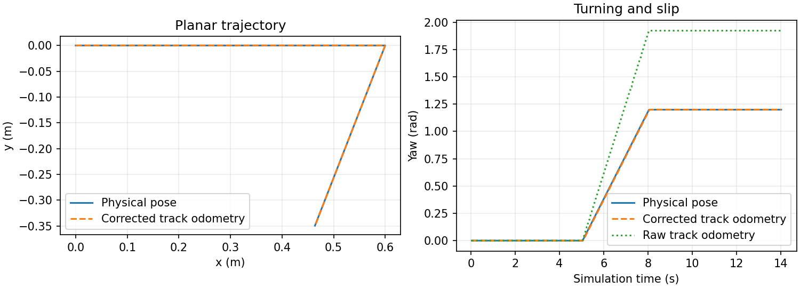

# BunkerMini Drive Test

## Objective and method

Verify the manufacturer's Mini mesh, Gazebo tracked drive, `/cmd_vel`, `/odom`, TF and command timeout. Environment: ROS 2 jazzy / Gazebo 8.11.0, isolated domain 71.

Fixed flat-ground sequence: stop for 1 s → drive forward at 0.2 m/s for 3 s → stop for 1 s → turn at 0.4 rad/s for 3 s → stop for 1 s → reverse at -0.15 m/s for 2 s → stop publishing commands, wait 2 s, then observe for 1 s. Motion phases use simulation time; the watchdog expires commands after 0.5 s of wall time.

## Results

Status: **passed**. Start time (UTC): `2026-10-27T22:29:26.983017+00:00`. Six saved-artifact checks: **passed**. GUI enabled: `False`.

| Check | Result | Unit | Acceptance criterion |
|---|---|---|---|
| Physical forward displacement | 0.592446 | m | 0.3 < x < 0.9 |
| Odometry forward displacement | 0.593200 | m | 0.3 < x < 0.9 |
| Physical positive rotation | 1.188290 | rad | 1.14 < x < 1.26 |
| Turn relative error | 0.009758 | fraction | x < 0.05 |
| Corrected odometry turn error | 0.001890 | rad | x < 0.05 |
| Reverse displacement along heading | -0.294811 | m | -0.5 < x < -0.15 |
| Drift over 1 s after timeout stop | 0.000000 | m | x < 0.03 |
| Odometry/TF translation difference | 0.000000 | m | x < 0.03 |



The plot compares physical pose, corrected track odometry and the retained raw yaw estimate. Flat-ground steering and odometry corrections have been validated on the maneuvers below; hardware dynamics remain uncalibrated.

## Steering correction and independent checks

| Item | Original | Corrected |
|---|---|---|
| Target rotation (rad) | 1.200000 | 1.200000 |
| Physical rotation (rad) | 0.745663 | 1.188290 |
| Relative turn error (%) | 37.86 | 0.98 |

The original fixture used steering efficiency 1.0. The measured steady track-to-body yaw gain was approximately 0.62370 in both +/-0.4 rad/s calibration turns. The frozen efficiency and odometry yaw scale are now **0.624** in [drive.json](testing_code/src/well_e_bunker_sim/config/drive.json).

The [diagnostic run](result/run_20261027T220231_218839Z/metrics.json) retains the original and compensated left/right turns and arcs. Parameters were fitted from its two efficiency=1 in-place cases. The following validation uses different turn rates (+/-0.2 and +/-0.6 rad/s) and wider arcs (0.2 m/s, +/-0.2 rad/s), without retuning:

| Validation case | Target (rad) | Physical (rad) | Turn error (%) | Odom yaw error (rad) | Passed |
|---|---|---|---|---|---|
| slow_left | 0.5000 | 0.4941 | 1.18 | 0.0013 | True |
| slow_right | -0.5000 | -0.4941 | 1.18 | 0.0013 | True |
| fast_left | 1.2000 | 1.1807 | 1.61 | 0.0023 | True |
| fast_right | -1.2000 | -1.1807 | 1.61 | 0.0023 | True |
| wide_arc_left | 0.6004 | 0.6096 | 1.54 | 0.0168 | True |
| wide_arc_right | -0.6000 | -0.6096 | 1.61 | 0.0168 | True |

Validation status: **passed**. Limits were set before execution: turn error <10%, odometry yaw error <0.05 rad and accumulated planar odometry error <0.05 m. Maximum planar error was 0.0345 m. Evidence: [validation metrics](result/run_20261027T220604_865829Z/metrics.json) and [run manifest](result/run_20261027T220604_865829Z/manifest.json).

The default smoke test is also stricter: its former 0.4-1.8 rad turning check is replaced by <5% error from 1.2 rad and <0.05 rad odometry turn error. Earlier result files are preserved.

Public `/odom` and `odom → base_link` now come from [odometry_adapter.py](testing_code/src/well_e_bunker_sim/scripts/odometry_adapter.py), which integrates raw track velocity with the calibrated yaw scale. It does **not** subscribe to simulator ground truth. Raw odometry/TF remain on `/simulation/track_odom` and `/simulation/track_tf`; the independent body pose remains available for evaluation only. Odometry covariance is not calibrated.

The correction is specific to this flat-ground simulated contact model. It is not a real Bunker Mini calibration or evidence for other terrain. The upstream [TrackedVehicle implementation](https://github.com/gazebosim/gz-sim/blob/gz-sim8/src/systems/tracked_vehicle/TrackedVehicle.cc) applies steering efficiency to track commands but integrates uncorrected virtual-wheel odometry; this is why adjusting the drive parameter alone is insufficient.


## Files and execution

| Location | Contents |
|---|---|
| [test_report.ipynb](test_report.ipynb) | Executed result replay, artifact/source integrity checks and trajectory plot; does not rerun ROS |
| [testing_code](testing_code) | ROS package, launchers, motion checks, log capture and report generation |
| [result/run_20261027T222926_983017Z](result/run_20261027T222926_983017Z) | Metrics, trajectory.csv, manifest, verification, observed topics, console/launch logs, SDF/URDF and plot |
| [result/initial_run](result/initial_run) | Original passing result and launch log from before reorganization; no trajectory was recorded |

On Windows, double-click `C:\Ubuntu\Test-Bunker-Mini.cmd` to run a new test or `C:\Ubuntu\Bunker-Mini-Sim.cmd` to open the simulation. Each test creates a new result directory and preserves earlier runs. `result/latest.json` points to the latest record.

```powershell
.\testing_code\Start-BunkerMini.ps1 -Action test
.\testing_code\Start-BunkerMini.ps1 -Action sim -Headless
```

From this test directory inside the container: `bash testing_code/run_test.sh [--gui] [--output <new-result-directory>]`. Use `--probe steering_validation` for the six fixed-gain validation maneuvers, or `--probe turning_test` for the diagnostic parameter comparison. Diagnostic runs do not replace the latest smoke-test pointer. Source: [model.py](testing_code/src/well_e_bunker_sim/launch/model.py), [sim.launch.py](testing_code/src/well_e_bunker_sim/launch/sim.launch.py), [watchdog](testing_code/src/well_e_bunker_sim/scripts/cmd_watchdog.py), [smoke_test](testing_code/src/well_e_bunker_sim/scripts/smoke_test.py), [runner](testing_code/tools/run_smoke_test.py).

Asset caches, generated files, build artifacts and raw ROS logs remain in `C:\Ubuntu\ROS`. The notebook environment is `reporting-venv` under that directory.

## Scope and limitations

The Mini STL is pinned to manufacturer commit `27633a956c845903ee630538afeb17fe70afdd84`. Total mass, 40.953842 kg, comes from the upstream single-body URDF. Contact boxes, inertia distribution, friction and steering efficiency are simulation assumptions. Collision boxes do not cover the complete CAD envelope. The provisional limits of 0.35 m/s and 0.6 rad/s are experiment settings, not confirmed hardware limits.

This stage includes no Nav2, map localization, LiDAR/ZED/IMU simulation or temperature measurement. GP/GRG is unchanged. The measured steering correction covers this fixed scene only; narrow passages, complex terrain, hardware performance and navigation accuracy remain untested.

Sources: [manufacturer Mini assets](https://github.com/agilexrobotics/ugv_gazebo_sim/tree/27633a956c845903ee630538afeb17fe70afdd84/bunker/bunker_mini), [manufacturer ROS 2 driver](https://github.com/agilexrobotics/bunker_ros2/tree/humble), [delivery documentation](https://indrorobotics.notion.site/MCMU-CA-03-3ab1bb7999b28041a889c0d6b5fe8203). The upstream asset package.xml declares BSD.
