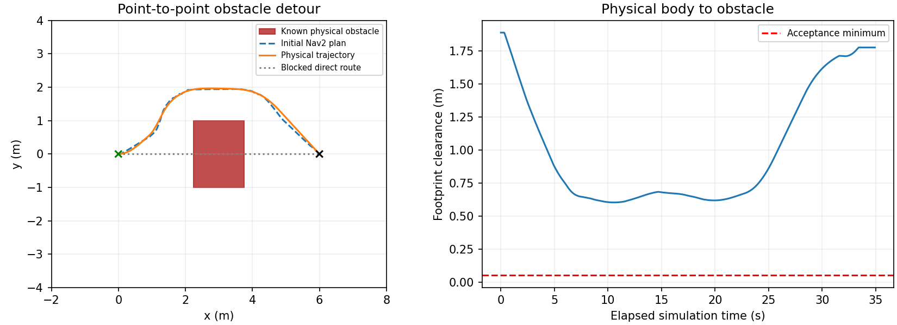

# Nav2 Point-to-Point Obstacle Test

## Objective and setup

Send one `NavigateToPose` goal to the calibrated Bunker Mini. Nav2 chooses and executes the route; no intermediate waypoints or manual velocity commands are supplied.

The field is 10 × 8 m, from x=-2 to 8 m and y=-4 to 4 m. Start: (0,0,0); goal: (6,0,0). A 1.5 × 2 × 1 m physical box at (3,0) blocks the direct route. A 0.05 m occupancy map describes the same obstacle and field boundary. The footprint covers the full CAD planar envelope, with 0.07 m costmap padding.

**Controlled assumptions:** the static obstacle is known in advance; a simulation-only ground-truth `map→odom` correction provides ideal localization. No AMCL, LiDAR, camera perception or unknown-obstacle detection is tested. The map feeds Nav2 static and inflation layers; NavFn plans and Regulated Pure Pursuit controls motion with footprint collision checking enabled.

## Results

Status: **passed**. Start (UTC): `2026-10-27T22:41:56.726349+00:00`. ROS 2 jazzy; Nav2 1.3.13-1noble.20261006.042503; Gazebo 8.11.0. GUI: `True`.

| Metric | Result | Unit |
|---|---:|---|
| Final position error | 0.148902 | m |
| Final heading error | 0.144164 | rad |
| Minimum full-body clearance | 0.602915 | m |
| Physical path length | 7.469374 | m |
| Initial planned path length | 7.714858 | m |
| Navigation duration | 33.436000 | s |
| Sampled footprint overlaps | 0.000000 | samples |



Acceptance requires Nav2 success, actual position/heading errors ≤0.20 m/rad, minimum footprint clearance ≥0.05 m, no sampled body/obstacle overlap, remaining inside the field, a visible detour and stopping after success. Nav2's internal position/heading tolerances are tighter: 0.15 m/rad. All 8 recorded checks passed.

Clearance uses oriented full-body footprint polygons and independent simulator body poses, rather than planned points or robot-center distance. Overlap counts are sampled geometric checks, not Gazebo contact-sensor events. One fixed scene does not establish continuous collision guarantees, statistical reliability or hardware performance.

## Embedded replay video

The [Notebook](test_report.ipynb) embeds a playable [MP4](result/run_20261027T224156_726349Z/replay/rosbag_replay.mp4) generated directly from the physical-pose messages in the MCAP recording. Duration: 35.08 s, at 1× simulation-time speed and 12 fps.

This is a top-down recorded-data visualization of the robot footprint, heading and route, **not camera footage or a Gazebo screen recording**. The bag contains no recorded image topics. Frames use the nearest recorded pose without interpolating positions. The scenario comes from the saved run configuration.

Provenance and full-video decode verification: [video_metadata.json](result/run_20261027T224156_726349Z/replay/video_metadata.json). Decoded bag poses: [bag_poses.csv](result/run_20261027T224156_726349Z/replay/bag_poses.csv). Creating the video does not rerun navigation or modify the original bag.


## Files and execution

| Location | Contents |
|---|---|
| [test_report.ipynb](test_report.ipynb) | Executed replay, trajectory, criteria and artifact checks |
| [testing_code](testing_code/README.md) | Scenario, launch, truth-localization fixture, action client and verification |
| [result/run_20261027T224156_726349Z](result/run_20261027T224156_726349Z) | Metrics, physical trajectory, initial plan, map, world, actual Nav2 parameters, logs and hashes |

## rosbag2 recording

The primary ROS recording is [rosbag/](result/run_20261027T224156_726349Z/rosbag), stored as MCAP with `metadata.yaml`. It contains **34961 messages across 21 topics**. Recording timestamps use simulation time. The recorder starts before the goal is sent and flushes before simulation shutdown.

| Recorded topic | Messages |
|---|---:|
| `/clock` | 18868 |
| `/cmd_vel` | 666 |
| `/global_costmap/costmap` | 63 |
| `/global_costmap/published_footprint` | 380 |
| `/local_costmap/costmap` | 61 |
| `/local_costmap/published_footprint` | 380 |
| `/lookahead_point` | 665 |
| `/map` | 1 |
| `/navigate_to_pose/_action/feedback` | 1679 |
| `/navigate_to_pose/_action/status` | 2 |
| `/odom` | 1885 |
| `/plan` | 30 |
| `/received_global_plan` | 87 |
| `/robot_description` | 1 |
| `/simulation/cmd_vel` | 760 |
| `/simulation/ground_truth/odom` | 1887 |
| `/simulation/track_odom` | 1887 |
| `/simulation/track_tf` | 1886 |
| `/test/navigation_goal` | 1 |
| `/tf` | 3771 |
| `/tf_static` | 1 |

Readback status: **passed**. The bag contains the map, static and dynamic TF, goal, action status and physical motion throughout navigation. The bag/analysis pose match fraction is 1.000; minimum footprint clearance independently recomputed from bag poses is 0.602915 m. CSV and JSON remain analysis products, checked against the authoritative ROS recording.

Actual ROS playback was also verified at 5× speed on isolated domain 73, without replaying velocity-command topics: **passed**. See [bag info](result/run_20261027T224156_726349Z/rosbag_info.txt), [readback checks](result/run_20261027T224156_726349Z/rosbag_summary.json), and [playback checks](result/run_20261027T224156_726349Z/rosbag_replay_verification.json).

To inspect or replay this run inside the container:

```bash
source /opt/ros/jazzy/setup.bash
export ROS_DOMAIN_ID=73
bag=/workspace/Code/10.27_ROS_simulation/Nav2_test/result/run_20261027T224156_726349Z/rosbag
ros2 bag info "$bag"
ros2 bag play "$bag" --clock --topics /tf /tf_static /map /odom /plan /robot_description /simulation/ground_truth/odom /test/navigation_goal /global_costmap/costmap /local_costmap/costmap
```

Use the same domain and `use_sim_time:=true` for RViz; set its fixed frame to `map`. This replays ROS data for inspection; it does not rerun Gazebo physics or reissue the navigation action. The visualization replay excludes velocity commands. Transient-local QoS overrides preserve latched map, static TF and model data; see [rosbag_qos.yaml](testing_code/src/well_e_nav2_test/config/rosbag_qos.yaml). Reference: [ROS 2 rosbag2 recording and QoS](https://github.com/ros2/rosbag2/blob/rolling/README.md).


From `Nav2_test/`:

```powershell
.\testing_code\Start-Nav2.ps1 -Action test -Gui
.\testing_code\Start-Nav2.ps1 -Action sim
```

Windows shortcuts: `C:\Ubuntu\Test-Nav2.cmd` runs the automatic GUI test; `C:\Ubuntu\Nav2-Sim.cmd` opens the scene. The existing container desktop is at <http://127.0.0.1:6080/vnc.html?autoconnect=1&resize=scale>. Tests use ROS domain 72 and Gazebo partition `well_e_nav2_test`. Each run is preserved separately. ROS logs, builds and caches remain under `C:\Ubuntu\ROS`.

## Coverage and next steps

Completed: a single goal, known static-obstacle detour, physical footprint clearance, arrival and stopping. Pending: unmapped-obstacle sensing, realistic localization, ordered waypoints, unreachable goals and explicit cancellation. GP/GRG integration remains in [Integration_test](../Integration_test/README.md), unimplemented.

Earlier failed setup attempts remain in their result directories, with failed status; their logs distinguish clock-QoS and action-acknowledgment setup issues from this successful run. This report displays the latest run without deleting those records.

Reference: [Nav2 Regulated Pure Pursuit](https://docs.nav2.org/rolling/configuration_and_development/configuration_guide/controller_plugins/configuring_regulated_pp/). The executed Jazzy parameter file is saved with the run; installed defaults are adapted to this fixture, not copied from rolling documentation.
