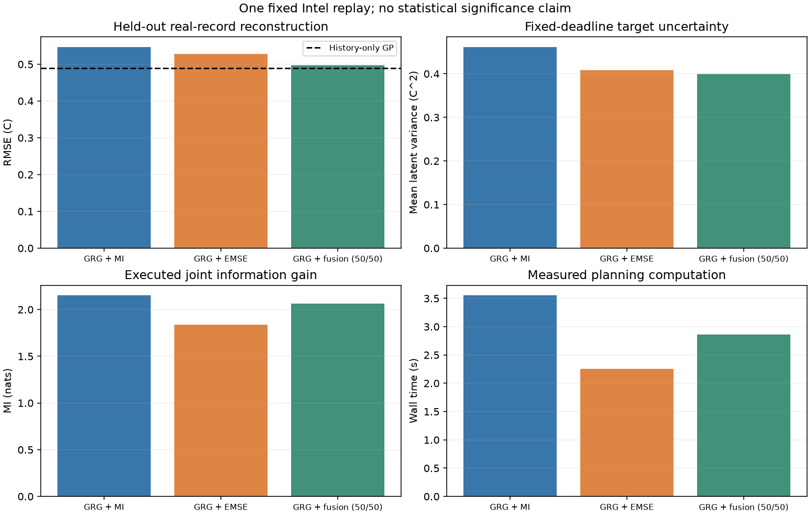
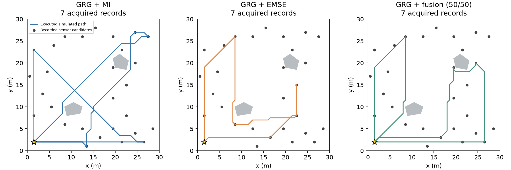
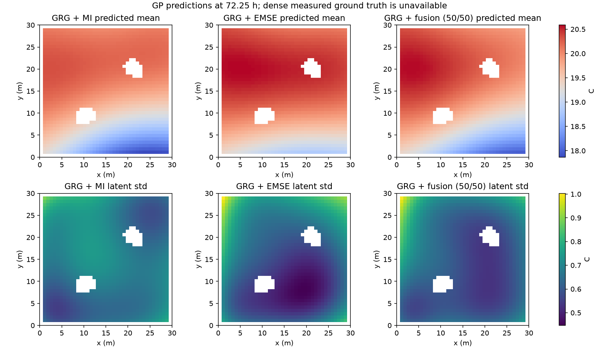

# 11.2 - GRG Policy Objective Comparison

## Purpose

Compare MI, target-field EMSE reduction, and normalized 50/50 fusion while retaining the existing GRG search, GP checkpoint, Intel data split, navigation, and measurement rules. This is a Python recorded-data replay in the existing Docker container, not a ROS/Nav2 integration experiment.

## Controlled protocol

- Reuse the 10.18 three-day, 2,000-observation GP checkpoint without retraining. Kernel parameters remain fixed; only successful acquisitions update the posterior.
- Same 29 recorded-sensor candidates, 30 x 30 m simulated map, obstacles, Home at sensor 16, 0.35 m/s speed, 5 s dwell, 900 s budget, depth 2, two time splits, and spatial revisits.
- Preserve the existing travel + acquisition waiting + dwell clock. Online computation is charged as zero, as in the old baseline; measured wall time is reported separately. All arms compute both objective components.
- Fixed policy target: 1393 reachable points on the original 0.75 m grid at 72.25 h. Target coordinates and timestamps are public; target temperatures are never supplied to the planner.
- Preserve the same 28 held-out real reference records. Their individual timestamps lie in the last five minutes of the mission. Evaluation is retrospective reconstruction, not a causal future forecast or a dense measured field.

## Objective definitions

For a scheduled route S and current observations D:

- **MI:** `0.5 * logdet(I + posterior_cov(S|D) / noise_variance)`.
- **EMSE:** maximize the average target latent-variance reduction, `trace(C_QS (C_SS + noise*I)^(-1) C_SQ) / n_Q`. Target uncertainty after sampling is minimized equivalently. This is a model-based expected-error objective, not access to unknown actual reconstruction error.
- **Fusion:** `0.5 * MI / s_MI + 0.5 * EMSE_reduction / s_EMSE`.

Both normalizers are fixed before any policy executes: the maximum initial single-event MI or EMSE gain over the same public acquisition-event catalog. `s_MI=0.512079966` nats and `s_EMSE=0.322096006` C^2. Route scores may exceed one and are not clipped. Equal weights mean equal relative weights under this declared normalization, not equal physical units or a proven optimal trade-off. No test temperatures or outcome metrics choose the scales or weights.

The subclass overrides only route scoring. All recursive subproblems use that same dispatch. No new GRG approximation guarantee is asserted for EMSE or fusion.

## Results

| Policy | Samples | Held-out RMSE (C) | MAE (C) | Target mean variance (C^2) | Joint MI (nats) | Planning wall time (s) |
|---|---:|---:|---:|---:|---:|---:|
| GRG + MI | 7 | 0.546907 | 0.417031 | 0.461534 | 2.152729 | 3.555 |
| GRG + EMSE | 7 | 0.527523 | 0.362148 | 0.408739 | 1.839464 | 2.253 |
| GRG + fusion (50/50) | 7 | 0.496601 | 0.379663 | 0.399477 | 2.063027 | 2.866 |

On this single recorded replay, GRG + fusion (50/50) has the lowest held-out RMSE (0.496601 C), while GRG + fusion (50/50) has the lowest target mean variance (0.399477 C^2). These are different quantities. This is one fixed dataset and mission window, not evidence of statistical superiority. No policy lowers RMSE below the history-only GP in this run.





## Verification and provenance

Seven analytic objective checks, independent full-target GPyTorch/Schur-complement checks before and after numerical-fixture updates, and historical MI-control reproduction must pass. Every arm checks record uniqueness, held-out separation, frozen parameters, valid posterior updates, route timing, collision freedom, return and budget feasibility. Saved predictions independently reproduce reported metrics. Hashes verify protected old inputs and experiment source files.

The MI control reproduces the old recorded route, acquisition records, trajectory and metrics within 1e-7; machine-dependent wall times are excluded. Precomputed conditional covariance is exact for the unchanged fixed-hyperparameter GP. The initial shared catalog preparation time is reported in `protocol.json`; it is outside the original simulated mission clock.

Previous user experiments compared GRG depths and before/after sampling. They did not perform this three-objective comparison. The reference repo's Notebook 06 changed kernel and objective together and did not forward its custom objective to recursive calls; this new experiment does not reuse that implementation.

## Files

- [Executed Notebook](11.2_test_report.ipynb)
- [Comparison table](11.2_result/run_20261103T020926Z/comparison.csv)
- [Fixed protocol](11.2_result/run_20261103T020926Z/protocol.json), [input/source manifest](11.2_result/run_20261103T020926Z/manifest.json)
- [Overall verification](11.2_result/run_20261103T020926Z/verification.json), [MI baseline reproduction](11.2_result/run_20261103T020926Z/mi_baseline_verification.json), [independent numerical verification](11.2_result/run_20261103T020926Z/numerical_verification.json)
- `11.2_result/run_20261103T020926Z/mi`, `/emse`, `/fusion`: individual records, paths, scheduled routes, score components, predictions, final GP checkpoints and execution logs.
- `testing_code/`: scoring, runner, verification, reporting and analytic tests. Original 10.16/10.18/10.27 files are not modified.

## Run in Docker

Use the existing `bunker-jazzy` container with the project mounted at `/workspace` and the isolated GP environment at `/home/ubuntu/.venvs/policy-compare`. It resides on the container Linux filesystem, separate from ROS Python. The exact dependency set is in `testing_code/requirements.txt`; it matches the old numerical package versions. If the container is recreated, recreate this isolated environment from that file.

```powershell
powershell -ExecutionPolicy Bypass -File .\testing_code\Start-PolicyCompare.ps1
```

```bash
/home/ubuntu/.venvs/policy-compare/bin/python -B /workspace/Code/11.2_policy_compare/testing_code/run_compare.py
/home/ubuntu/.venvs/policy-compare/bin/python -B /workspace/Code/11.2_policy_compare/testing_code/build_report.py
```

Each run creates a new timestamped directory. Existing runs are never overwritten. Readiness checks and raw artifacts are preserved when an execution fails. This initial 50/50 test does not tune weights, compare kernels, add edge sampling, or change ROS integration.
