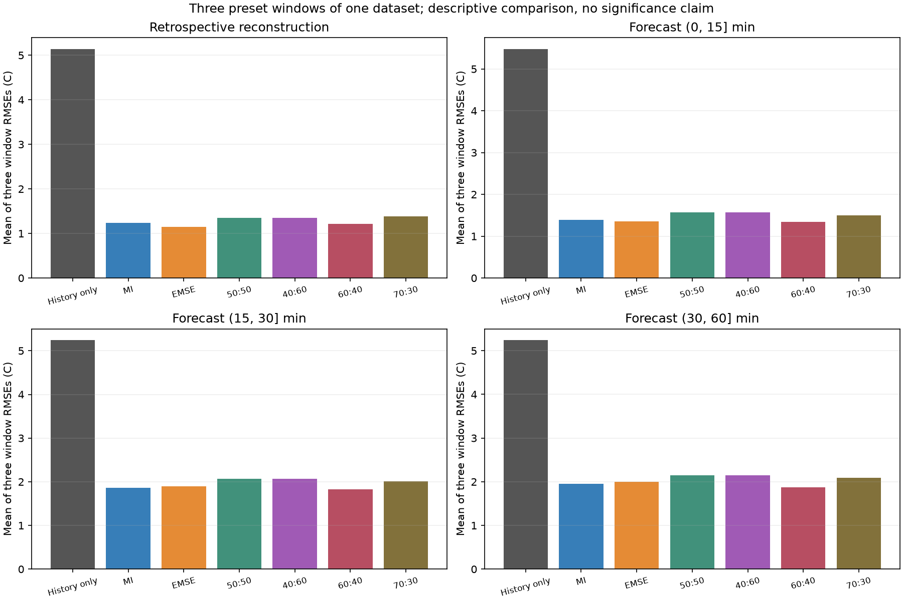
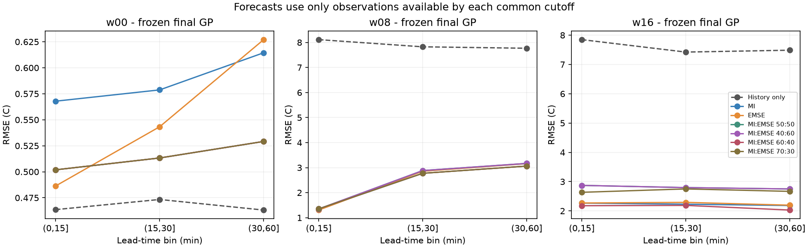
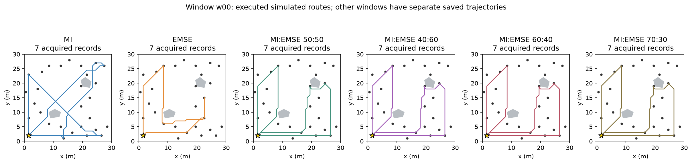

# 11.2 - MI:EMSE 70:30 Follow-up

## Protocol and provenance

This is an exploratory follow-up requested after viewing the earlier five-policy comparison. Only three new 70:30 missions were executed, at the unchanged mission starts 72, 80 and 88 hours. The 15 earlier missions, three history-only controls, public acquisition catalogs, travel matrices, reference records and numerical checks are reused byte-for-byte and their hashes are verified. Existing run directories, reports and result pointers remain intact.

The new objective is `0.7 * MI / s_MI + 0.3 * EMSE_reduction / s_EMSE`. The unchanged normalizers were fixed from initial single-event gains within each window. Saved scores independently verify that every selected route uses MI weight 0.7 and EMSE weight 0.3. There is no new kernel training or change to the GP checkpoint, GRG depth 2, candidate nodes, synthetic map, navigation, 0.35 m/s speed, 5 s dwell or 900 s budget. Computation remains outside the original simulated mission clock; measured wall times are recorded separately.

Reconstruction uses the same latest held-out actual record per reachable sensor in the last five minutes before the mission deadline. This is retrospective reconstruction at recorded locations, not dense measured map truth or a held-out-sensor test. Forecasts freeze the final GP at the same common deadline and evaluate strictly later held-out records in (0,15], (15,30] and (30,60] minutes, with no future conditioning. EMSE still targets the deadline field; future forecasting is an additional evaluation, not a changed planning objective.

Primary summary values are arithmetic means of the three window RMSEs, in C; lower is better. MAE, sensor-balanced RMSE and predictive coverage are also saved in the aggregate CSV; per-window metric JSONs additionally include NLPD. The three windows are correlated portions of one dataset. Adding 70:30 after inspecting the earlier results is exploratory tuning on the same evaluation windows, not independent validation of a best ratio. Any selected ratio still needs a separate-day or separate-field test.

## Mean window RMSE comparison

| Policy (MI:EMSE) | Reconstruction | Forecast (0,15] min | Forecast (15,30] min | Forecast (30,60] min |
|---|---:|---:|---:|---:|
| History only | 5.137181 | 5.474390 | 5.240287 | 5.239110 |
| MI | 1.239073 | 1.395163 | 1.860237 | 1.953275 |
| EMSE | 1.152650 | 1.353696 | 1.896846 | 1.993748 |
| MI:EMSE 50:50 | 1.355537 | 1.573829 | 2.063748 | 2.149030 |
| MI:EMSE 40:60 | 1.355537 | 1.573829 | 2.063748 | 2.149030 |
| MI:EMSE 60:40 | 1.217038 | 1.343509 | 1.824843 | 1.873229 |
| MI:EMSE 70:30 | 1.378565 | 1.496170 | 2.012189 | 2.085897 |

## 70:30 versus 60:40

- Retrospective reconstruction: 70:30 = 1.378565 C, 60:40 = 1.217038 C; difference = +0.161527 C (negative favors 70:30).
- Forecast (0, 15] min: 70:30 = 1.496170 C, 60:40 = 1.343509 C; difference = +0.152661 C (negative favors 70:30).
- Forecast (15, 30] min: 70:30 = 2.012189 C, 60:40 = 1.824843 C; difference = +0.187347 C (negative favors 70:30).
- Forecast (30, 60] min: 70:30 = 2.085897 C, 60:40 = 1.873229 C; difference = +0.212669 C (negative favors 70:30).

- w00: 70:30 acquired the identical ordered record sequence as MI:EMSE 50:50, MI:EMSE 40:60, MI:EMSE 60:40.
- w08: 70:30 acquired the identical ordered record sequence as MI, MI:EMSE 60:40.
- w16: 70:30 acquired a different ordered record sequence from all earlier arms.




## Per-window RMSE

| Window | Policy | Reconstruction RMSE | Forecast (0,15] | Forecast (15,30] | Forecast (30,60] |
|---|---|---:|---:|---:|---:|
| w00 | History only | 0.489578 | 0.463602 | 0.473355 | 0.463175 |
| w00 | MI | 0.546907 | 0.567876 | 0.578728 | 0.614442 |
| w00 | EMSE | 0.527523 | 0.486340 | 0.543291 | 0.627064 |
| w00 | MI:EMSE 50:50 | 0.496601 | 0.501875 | 0.513260 | 0.529163 |
| w00 | MI:EMSE 40:60 | 0.496601 | 0.501875 | 0.513260 | 0.529163 |
| w00 | MI:EMSE 60:40 | 0.496601 | 0.501875 | 0.513260 | 0.529163 |
| w00 | MI:EMSE 70:30 | 0.496601 | 0.501875 | 0.513260 | 0.529163 |
| w08 | History only | 7.644961 | 8.111826 | 7.824759 | 7.767400 |
| w08 | MI | 1.242893 | 1.351817 | 2.773157 | 3.061642 |
| w08 | EMSE | 0.989282 | 1.305019 | 2.855750 | 3.158509 |
| w08 | MI:EMSE 50:50 | 1.194340 | 1.348177 | 2.882170 | 3.168412 |
| w08 | MI:EMSE 40:60 | 1.194340 | 1.348177 | 2.882170 | 3.168412 |
| w08 | MI:EMSE 60:40 | 1.242893 | 1.351817 | 2.773157 | 3.061642 |
| w08 | MI:EMSE 70:30 | 1.242893 | 1.351817 | 2.773157 | 3.061642 |
| w16 | History only | 7.277005 | 7.847742 | 7.422747 | 7.486755 |
| w16 | MI | 1.927421 | 2.265797 | 2.228827 | 2.183742 |
| w16 | EMSE | 1.941144 | 2.269729 | 2.291498 | 2.195671 |
| w16 | MI:EMSE 50:50 | 2.375668 | 2.871435 | 2.795814 | 2.749514 |
| w16 | MI:EMSE 40:60 | 2.375668 | 2.871435 | 2.795814 | 2.749514 |
| w16 | MI:EMSE 60:40 | 1.911620 | 2.176834 | 2.188111 | 2.028881 |
| w16 | MI:EMSE 70:30 | 2.396200 | 2.634816 | 2.750152 | 2.666887 |

## Executed routes

The plot shows all six sampling policies at w00. Every window has its own saved trajectory, acquired records, score components, final GP and predictions.



## Verification and files

- [Executed Notebook](11.2_70_30_test_report.ipynb)
- [Full metric table](11.2_result/strict_plus_70_30_20261103T025338Z/aggregate.csv), [per-window results](11.2_result/strict_plus_70_30_20261103T025338Z/evaluation.csv)
- [Frozen six-policy configuration](11.2_result/strict_plus_70_30_20261103T025338Z/config_frozen.json), [provenance manifest](11.2_result/strict_plus_70_30_20261103T025338Z/manifest.json)
- [Causal/metric/input verification](11.2_result/strict_plus_70_30_20261103T025338Z/verification.json), [copy and 70:30 score verification](11.2_result/strict_plus_70_30_20261103T025338Z/extension_verification.json)
- `11.2_result/strict_plus_70_30_20261103T025338Z/windows/w00/fusion_70_30`, `/w08/fusion_70_30`, `/w16/fusion_70_30`: the three newly executed missions. All other arm folders contain verified copies of the earlier results, including their original timing logs.
- Earlier reports are preserved: [five-policy report](README_strict.md), [original three-policy report](README.md).

The unchanged 12 analytic and timestamp tests were rerun successfully. Each new mission passes the original budget, return, trajectory, acquisition, fixed-parameter and posterior checks. Forecast records are common across policies, disjoint from acquired record IDs and strictly beyond the cutoff; saved predictions reproduce the metrics. The copied earlier inputs and results are hash-identical, and all older protected artifacts are unchanged.

From this experiment directory, in the existing Docker environment:

```powershell
powershell -ExecutionPolicy Bypass -File .\testing_code\Start-70-30Compare.ps1
```

The command reruns only the 70:30 arm for the same three windows and creates a new timestamped extension. It does not rerun ROS/Nav2 or modify the earlier five-policy configuration. `latest_70_30.json` identifies this extension; older pointers are preserved.
