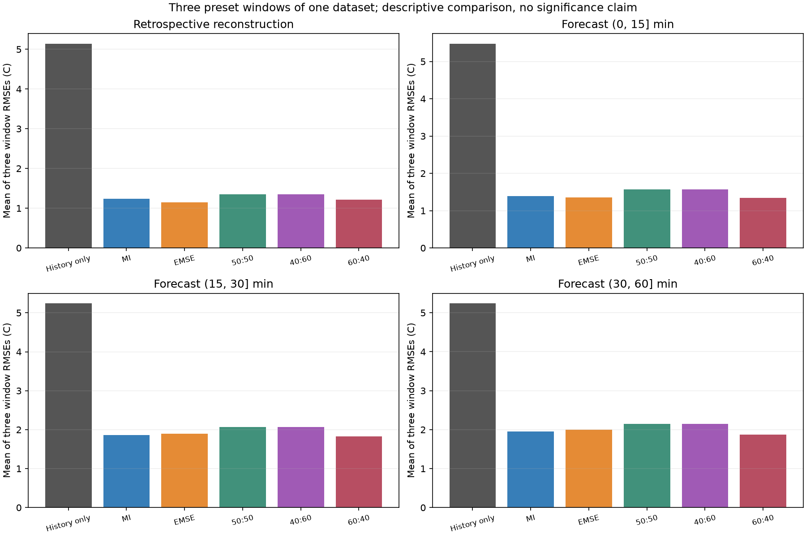
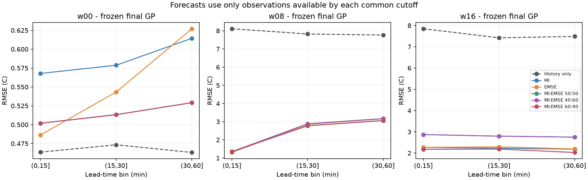
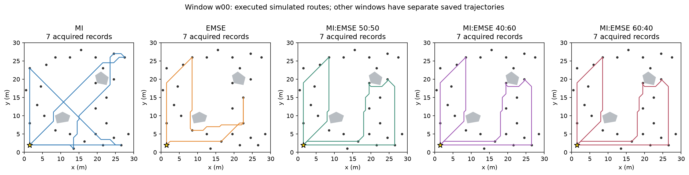

# 11.2 - Strict Reconstruction and Forecast Comparison

## Fixed protocol

Five preset arms: MI, EMSE, MI:EMSE 50:50, 40:60, and 60:40. The order is always MI then EMSE. Fusion uses `J = w_MI * MI/s_MI + w_EMSE * EMSE_reduction/s_EMSE`; raw MI and EMSE have different units and are not directly added. Normalizers are the unchanged maximum initial single-event gains, shared by all arms within each window and frozen before sampling. No test temperature selects weights or normalizers.

All arms reuse the same three-day/2,000-observation GP checkpoint, fixed kernel parameters, 29 candidate sensors, synthetic map and obstacles, Home, navigation, 0.35 m/s speed, 5 s dwell, 900 s budget, GRG depth 2 and two time splits. The only policy change is route scoring. Successful recorded acquisitions condition the posterior; there is no kernel refit. Every arm computes both score components.

Three preset mission starts are 72, 80 and 88 hours from the dataset origin (day-four 00:00, 08:00 and 16:00 in the original timestamp convention; timezone unspecified). Each is an independent replay reset to the same checkpoint, not a multi-window online trajectory. The last two therefore start with older information. The three windows are correlated parts of one dataset, not independent repeated trials. No confidence interval or statistical-superiority claim is justified by these three windows alone.

The original clock counts travel, acquisition waiting and dwell but charges online computation as zero. Planning wall time is saved separately. This is Python recorded-data replay, not a real-time or ROS/Nav2 experiment. Both the planning/execution acquisition schedule and return-to-Home budget are checked.

## Evaluation and leakage boundaries

**Reconstruction:** after the 15-minute mission, evaluate the latest odd-index held-out observation per reachable sensor in the last five minutes before the common deadline. Predictions use each record's actual timestamp. This is retrospective window reconstruction; it is neither a simultaneous dense measured field nor a causal forecast for those pre-cutoff records.

**Forecasting:** the common forecast origin is mission start plus 15 minutes. Reload each saved final GP and freeze it. Evaluate only odd-index held-out records in `(0,15]`, `(15,30]` and `(30,60]` minutes after that origin. No future observations are appended and no parameters change. The history-only GP uses the same origins and test records. Acquisition pools are truncated at the common cutoff, and acquisition/test record IDs are disjoint. Forecast truths are used solely for evaluation.

**Objective versus evaluation:** EMSE still targets the same reachable grid at the mission deadline. The future forecast scores are additional outcomes; this run does not change EMSE into a future-horizon objective. Model-based expected squared error / latent variance is distinct from empirical error on held-out temperatures. Lower target variance does not guarantee lower measured RMSE.

**Metrics:** primary empirical RMSE and MAE use identical records for all policies within each task/window. NLPD and 95% predictive coverage use observation variance, including learned noise. Sensor-balanced RMSE gives sensors equal weight despite unequal logging rates. The summary below is the arithmetic mean of three window RMSEs, not pooled-record RMSE. Per-window results and record counts are retained to expose variation.

**Spatial scope:** the preserved split alternates records within each sensor; sensors themselves are not held out from acquisition. Nearby records are correlated, and dense measured ground truth is unavailable. Reconstruction therefore tests the recorded reachable locations, not spatial extrapolation to entirely unseen sensors or true error over the entire map. The future bins provide the separate temporal holdout. A later spatial-generalization claim would require a separate held-out-location protocol.

## Results

Mean of three window RMSEs (C), lower is better:

| Policy (MI:EMSE) | Reconstruction | Forecast (0,15] min | Forecast (15,30] min | Forecast (30,60] min |
|---|---:|---:|---:|---:|
| History only | 5.137181 | 5.474390 | 5.240287 | 5.239110 |
| MI | 1.239073 | 1.395163 | 1.860237 | 1.953275 |
| EMSE | 1.152650 | 1.353696 | 1.896846 | 1.993748 |
| MI:EMSE 50:50 | 1.355537 | 1.573829 | 2.063748 | 2.149030 |
| MI:EMSE 40:60 | 1.355537 | 1.573829 | 2.063748 | 2.149030 |
| MI:EMSE 60:40 | 1.217038 | 1.343509 | 1.824843 | 1.873229 |

- Retrospective reconstruction: lowest mean window RMSE among sampling arms is **EMSE**, 1.152650 C; history only is 5.137181 C.
- Forecast (0, 15] min: lowest mean window RMSE among sampling arms is **MI:EMSE 60:40**, 1.343509 C; history only is 5.474390 C.
- Forecast (15, 30] min: lowest mean window RMSE among sampling arms is **MI:EMSE 60:40**, 1.824843 C; history only is 5.240287 C.
- Forecast (30, 60] min: lowest mean window RMSE among sampling arms is **MI:EMSE 60:40**, 1.873229 C; history only is 5.239110 C.

These describe this fixed dataset and these preset windows. They do not establish a universally best ratio or validate weight tuning on the same outcomes. A later confirmatory comparison should freeze the selected setting and use separate days or field data. Comparisons of this frozen-kernel model do not identify an optimal kernel.

Identical acquisitions can occur because the route choices are discrete; changing weights need not change the selected route. With the same fixed GP and identical acquisitions, predictions are identical:

- w00: MI:EMSE 50:50, MI:EMSE 40:60, MI:EMSE 60:40 acquired the identical ordered record sequence.
- w08: MI, MI:EMSE 60:40 acquired the identical ordered record sequence.
- w08: MI:EMSE 50:50, MI:EMSE 40:60 acquired the identical ordered record sequence.
- w16: MI:EMSE 50:50, MI:EMSE 40:60 acquired the identical ordered record sequence.




## Per-window results

All entries are empirical RMSE in C. Windows w00, w08 and w16 start at 72, 80 and 88 hours.

| Window | Policy | Reconstruction RMSE | Forecast (0,15] | Forecast (15,30] | Forecast (30,60] |
|---|---|---:|---:|---:|---:|
| w00 | History only | 0.489578 | 0.463602 | 0.473355 | 0.463175 |
| w00 | MI | 0.546907 | 0.567876 | 0.578728 | 0.614442 |
| w00 | EMSE | 0.527523 | 0.486340 | 0.543291 | 0.627064 |
| w00 | MI:EMSE 50:50 | 0.496601 | 0.501875 | 0.513260 | 0.529163 |
| w00 | MI:EMSE 40:60 | 0.496601 | 0.501875 | 0.513260 | 0.529163 |
| w00 | MI:EMSE 60:40 | 0.496601 | 0.501875 | 0.513260 | 0.529163 |
| w08 | History only | 7.644961 | 8.111826 | 7.824759 | 7.767400 |
| w08 | MI | 1.242893 | 1.351817 | 2.773157 | 3.061642 |
| w08 | EMSE | 0.989282 | 1.305019 | 2.855750 | 3.158509 |
| w08 | MI:EMSE 50:50 | 1.194340 | 1.348177 | 2.882170 | 3.168412 |
| w08 | MI:EMSE 40:60 | 1.194340 | 1.348177 | 2.882170 | 3.168412 |
| w08 | MI:EMSE 60:40 | 1.242893 | 1.351817 | 2.773157 | 3.061642 |
| w16 | History only | 7.277005 | 7.847742 | 7.422747 | 7.486755 |
| w16 | MI | 1.927421 | 2.265797 | 2.228827 | 2.183742 |
| w16 | EMSE | 1.941144 | 2.269729 | 2.291498 | 2.195671 |
| w16 | MI:EMSE 50:50 | 2.375668 | 2.871435 | 2.795814 | 2.749514 |
| w16 | MI:EMSE 40:60 | 2.375668 | 2.871435 | 2.795814 | 2.749514 |
| w16 | MI:EMSE 60:40 | 1.911620 | 2.176834 | 2.188111 | 2.028881 |

## Actual held-out coverage

| Window | Task | Held-out records | Sensors | Actual timestamps (h) |
|---|---|---:|---:|---|
| w00 | reconstruction | 28 | 28 | 72.19963200 - 72.24956030 |
| w00 | forecast_0_15m | 256 | 29 | 72.25008451 - 72.49955174 |
| w00 | forecast_15_30m | 263 | 29 | 72.50020059 - 72.74932354 |
| w00 | forecast_30_60m | 526 | 29 | 72.75692906 - 73.24933042 |
| w08 | reconstruction | 29 | 29 | 80.19065438 - 80.24964820 |
| w08 | forecast_0_15m | 261 | 29 | 80.25003490 - 80.49981727 |
| w08 | forecast_15_30m | 245 | 29 | 80.50710137 - 80.74996864 |
| w08 | forecast_30_60m | 496 | 29 | 80.75709886 - 81.24940934 |
| w16 | reconstruction | 29 | 29 | 88.16683780 - 88.24989319 |
| w16 | forecast_0_15m | 244 | 29 | 88.25730049 - 88.49995427 |
| w16 | forecast_15_30m | 244 | 29 | 88.50016968 - 88.74998324 |
| w16 | forecast_30_60m | 497 | 29 | 88.75729475 - 89.24983136 |

## Mission accounting

| Window | Policy | Acquisitions | Simulated mission (s) | Planning wall time (s) |
|---|---|---:|---:|---:|
| w00 | MI | 7 | 870.259 | 3.513 |
| w00 | EMSE | 7 | 870.259 | 2.455 |
| w00 | MI:EMSE 50:50 | 7 | 870.259 | 2.919 |
| w00 | MI:EMSE 40:60 | 7 | 870.259 | 3.024 |
| w00 | MI:EMSE 60:40 | 7 | 870.259 | 2.898 |
| w08 | MI | 11 | 899.389 | 5.299 |
| w08 | EMSE | 9 | 899.389 | 4.511 |
| w08 | MI:EMSE 50:50 | 8 | 899.389 | 3.643 |
| w08 | MI:EMSE 40:60 | 8 | 899.389 | 3.482 |
| w08 | MI:EMSE 60:40 | 11 | 899.389 | 5.146 |
| w16 | MI | 10 | 898.821 | 4.523 |
| w16 | EMSE | 7 | 863.581 | 3.711 |
| w16 | MI:EMSE 50:50 | 8 | 898.821 | 3.122 |
| w16 | MI:EMSE 40:60 | 8 | 898.821 | 3.139 |
| w16 | MI:EMSE 60:40 | 9 | 898.821 | 4.186 |



## Verification

The five timestamp/split/weight tests and seven analytic objective tests pass. Each window also passes independent GPyTorch-versus-cached covariance/Schur-complement checks. Every mission checks frozen hyperparameters, unique and chronological acquisitions, valid posterior updates, held-out separation, feasible collision-free routes, matching schedules and budgeted return. Forecast verification checks that the final training timestamps are no later than the common origin and that evaluating future records leaves GP training data and parameters unchanged.

Saved prediction CSVs independently reproduce every task metric. The first window's MI, EMSE and 50:50 arms reproduce the earlier three-policy records, routes, trajectories and metrics within 1e-7; wall time is excluded. Input/source SHA-256 checks preserve the earlier successful run, original README/Notebook/latest pointer, and reused older experiment files.

## Artifacts and reproduction

- [Executed Notebook](11.2_strict_test_report.ipynb)
- [Preset configuration](testing_code/strict_config.json)
- [Per-window/task metrics](11.2_result/strict_run_20261103T024044Z/evaluation.csv), [aggregate metrics](11.2_result/strict_run_20261103T024044Z/aggregate.csv)
- [Verification](11.2_result/strict_run_20261103T024044Z/verification.json), [provenance and environment](11.2_result/strict_run_20261103T024044Z/manifest.json)
- `11.2_result/strict_run_20261103T024044Z/windows/w00`, `/w08`, `/w16`: common held-out record lists, catalogs and travel matrices; each policy contains acquisition records, trajectories, planned routes, score components, final GP, predictions, metrics and logs. `history_only` is the no-new-measurement control.
- The original three-policy report and run remain intact. New runs use `latest_strict.json`; `latest.json` still identifies the earlier run.

From this experiment folder, with Docker Desktop running and the existing `bunker-jazzy` container and `/home/ubuntu/.venvs/policy-compare` environment available:

```powershell
powershell -ExecutionPolicy Bypass -File .\testing_code\Start-StrictCompare.ps1
```

This creates a new timestamped run, verifies it, and builds this report and executed Notebook. The Notebook analyzes saved artifacts without rerunning missions. Dependencies are the pinned existing `requirements.txt` / `requirements-lock.txt`. No ROS launch, new kernel, map change, continuous along-path sampling or Nav2 integration is introduced.
