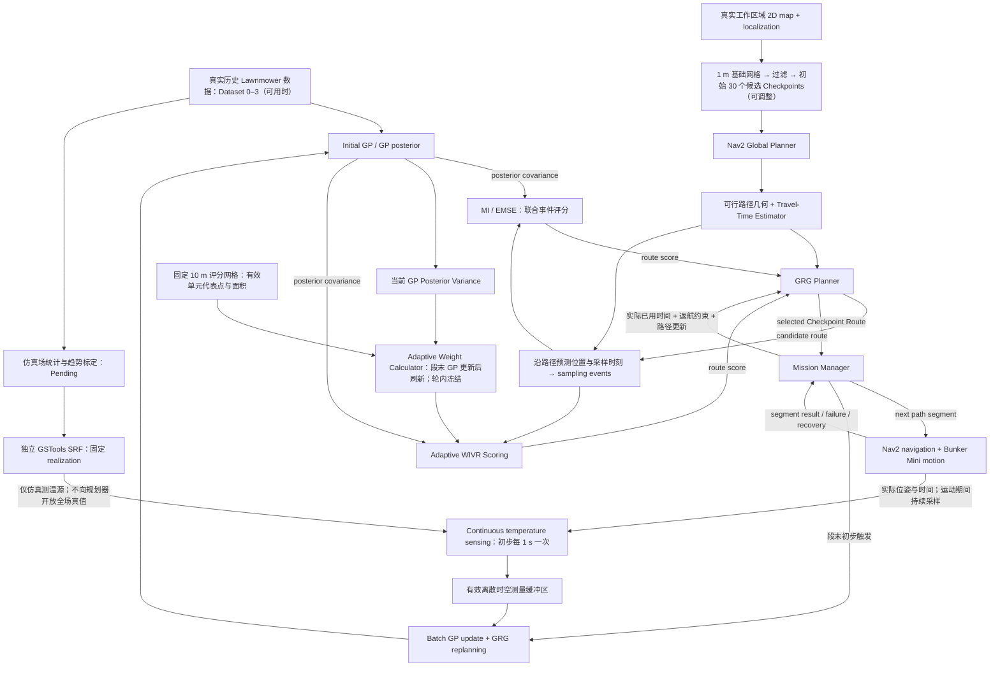

# WELL-E 项目核心逻辑

> 当前研究设计：采用 **Continuous Edge Sensing**，机器人沿 Nav2 路径运动时持续获取温度。GP 表示时空温度场，MI、EMSE、Adaptive WIVR 评价整条路线沿途预计产生的时空测量信息，GRG 优化有序 Checkpoint Route，Mission Manager 协调导航、测量缓冲、分段批量 GP 更新、重规划和返航。
>
> 状态边界：本文更新研究逻辑与实验计划。已有节点采样、Python 回放和 ROS 2 合成测试保留为历史记录；Adaptive WIVR 权重设计已确定（Design Defined）；连续沿边采样、GSTools SRF 和动态权重计算仍需实现和验证（Implementation Pending）。§0–9 用中文解释逻辑，§10 用英文说明实验设计。

## 0. 系统总流程与反馈关系



总体架构仍为 **GP–GRG–Nav2–Mission Manager**。Adaptive Weight Calculator 查询固定 10 m 空间评分网格上的当前 GP 后验方差，结合有效单元面积生成 WIVR 权重；初始化与每次实际 Batch GP Update 后计算，在一轮 GRG 搜索内冻结。MI 和 EMSE 不经过该权重模块。Checkpoint 是高层路线优化与分段执行的参考位置，不再等同于必须停车取得一条温度记录的位置。传感器在导航期间持续产生数据，初步在每段 Checkpoint-to-Checkpoint 路径完成后，批量更新 GP 并重新运行 GRG；实际更新频率和目标切换方式仍为 Pending。

规划阶段只使用 GP 后验、地图、可行路径和预计采样事件。仿真中的温度由独立的 $T_{\mathrm{sim}}(x,y,t)$ 按实际仿真位姿和时间查询，真实传感器则直接产生观测。模拟场真值只能通过测温接口返回当前允许取得的测量，以及供离线评价使用，不能让 GRG 直接读取未测位置的真值。

已有节点式 ROS 2 原型中的到点采样、固定驻留和记录查询流程属于历史实验。删除文档中的固定驻留，不代表当前代码已经完成连续采样、无停顿目标切换或 SRF 集成。

---

## 1. 温度场与连续采样产生的离散含噪观测

未知真实温度场统一写为

$$
T:\mathbb R^3\rightarrow\mathbb R,
\qquad
\mathbf z=[x,y,t]^\top.
$$

本文使用以下温度符号，避免将空间坐标 $y$ 与温度观测混用：

| 符号 | 含义 |
| --- | --- |
| $T(\mathbf z)$ | 真实环境的潜在温度 |
| $T_{\mathrm{sim}}(\mathbf z;\eta)$ | 随机场种子/实现标识 $\eta$ 对应的模拟温度真值 |
| $\widetilde T_i$ | 传感器取得的含噪温度，日志中对应 `temperature_c` |
| $\mu(\mathbf z),\sigma^2(\mathbf z)$ | GP 对潜在温度的后验均值与方差 |

Continuous Sensing 表示运动期间持续获取数据，不表示保存无限多个连续值。初步设定传感间隔 $\Delta t_s=1\,\mathrm{s}$，形成有限离散观测：

$$
\mathcal D=\{(\mathbf z_i,\widetilde T_i)\}_{i=1}^{N},
\qquad
\widetilde T_i=T(\mathbf z_i)+\epsilon_i,
\qquad
\epsilon_i\sim\mathcal N(0,\sigma_n^2).
$$

仿真时，相应的观测模型为

$$
\widetilde T_i^{\mathrm{sim}}
=T_{\mathrm{sim}}(\mathbf z_i;\eta)+\epsilon_i^{\mathrm{sim}}.
$$

每条日志保留实际位置、实际时间戳、温度、记录身份和质量状态；实际时空输入来自定位与任务时钟，不使用预计 Checkpoint 到达时间替代。传感器沿两节点之间的路径测量，因此每个 Checkpoint 对应的沿途测量数不固定，样本数也不等于访问的 Checkpoint 数。

1 s 是拟采用的采样间隔，不是每个 Checkpoint 的停车测量时长。真实传感器响应时间、时钟对齐、有效 1 Hz 测量能力及噪声统计仍为 Pending；当前独立高斯噪声只是建模假设。相邻时空测量的场相关性与冗余由 GP 联合协方差处理，不能把每秒取得的数据都视为独立信息。

## 2. GP 先验与 3D ARD RBF Kernel

对未知函数设置 GP 先验：

$$
T(\mathbf z)\sim
\mathcal{GP}\!\left(m(\mathbf z),k(\mathbf z,\mathbf z')\right).
$$

WELL-E 使用的三维 ARD RBF kernel 为

$$
\boxed{
k(\mathbf z,\mathbf z')=
\sigma_f^2
\exp\!\left[
-\frac12\left(
\frac{(x-x')^2}{\ell_x^2}
+\frac{(y-y')^2}{\ell_y^2}
+\frac{(t-t')^2}{\ell_t^2}
\right)
\right]
}
$$

其超参数可记为

$$
\boldsymbol\theta=
\{\sigma_f^2,\ell_x,\ell_y,\ell_t,\sigma_n^2\}.
$$

- $\sigma_f^2$ 控制潜在温度场的信号方差；
- $\ell_x,\ell_y,\ell_t$ 分别控制两个空间方向和时间方向的相关尺度；
- ARD 允许三个方向具有不同变化速率。

Kernel 的关键含义是

$$
k(\mathbf z,\mathbf z')
=\operatorname{Cov}\!\left(T(\mathbf z),T(\mathbf z')\right).
$$

因此，它不仅决定某个测量如何影响邻近位置的预测均值，也决定测量后其他位置的不确定性下降多少。它还是后续 MI 的基础：两个高度相关的采样点通常存在信息冗余。

GP conditioning 与超参数学习是两个步骤：固定 $\boldsymbol\theta$ 时，新观测通过后验公式更新预测；若需要重新学习相关尺度和噪声参数，则另行优化 $\boldsymbol\theta$。

## 3. GP 后验均值与协方差

令训练输入为 $X=[\mathbf z_1,\ldots,\mathbf z_N]^\top$，观测向量为 $\widetilde{\mathbf T}$，查询集合为 $Z_*$。定义

$$
C=K_{XX}+\sigma_n^2I.
$$

GP conditioning 给出潜在温度场的后验均值：

$$
\boxed{
\boldsymbol\mu_*
=\mathbf m_*+K_{*X}C^{-1}(\widetilde{\mathbf T}-\mathbf m_X)
}
$$

以及后验协方差：

$$
\boxed{
\Sigma_*
=K_{**}-K_{*X}C^{-1}K_{X*}
}
$$

即

$$
T(Z_*)\mid\mathcal D
\sim\mathcal N(\boldsymbol\mu_*,\Sigma_*).
$$

这里 $\operatorname{diag}(\Sigma_*)$ 是**潜在温度场**的 posterior variance；未来含噪观测的 predictive covariance 则为 $\Sigma_*+\sigma_n^2I$。固定时间 $t$ 后，$\mu(x,y,t)$ 形成预测温度图，$\sigma^2(x,y,t)$ 形成不确定性图。

实际计算中应通过 Cholesky 分解或线性方程求解实现上述表达式，而不是显式构造 $C^{-1}$。

## 4. 路线评分：MI、EMSE 与 WIVR

三种目标共用 GP 后验协方差。MI 衡量联合信息量，EMSE 衡量固定时空评价域内的平均预期误差降低，Adaptive WIVR 对相同评价域的方差降低加入当前 GP 不确定性驱动的空间权重，不额外定义时间重要性函数。GRG 每次选择其中一种评分函数；新设计的评分对象统一为**沿整条路线预计产生的测量事件集合**。

### 4.1 从 Checkpoint Route 构造沿路径采样事件

高层路线仍写为

$$
P=[v_0,v_1,\ldots,v_M],
$$

但 Nav2 为相邻 Checkpoints 提供的是路径 $\pi_{ij}$，而非仅一条直线。将这些路径、预计运动速度/转弯行为和预计时间安排连接起来，得到预计运动轨迹 $\widehat{\mathbf p}_P(\tau)$。在共同采样时钟的预计采样时刻 $\tau_r$ 上构造

$$
S(P;t_k)=\left\{
\begin{bmatrix}
\widehat x_P(\tau_r)\\
\widehat y_P(\tau_r)\\
t_k+\tau_r
\end{bmatrix}
\right\}_{r=1}^{N(P)}.
$$

这里 $N(P)$ 是预计测量数，并不等于 Checkpoint 数 $M$。初步使用 1 s 的采样间隔；采样相位应跨路径段连续维护，在段连接处避免重复计入同一事件。规划和等待引起的时间偏移必须反映在后续事件的绝对时间中。返航属于导航运动，拟按同一规则持续采样；规划暂停、等待与恢复期间的采样/缓冲规则需在实验前固定并验证。

MI、EMSE 和 WIVR 都评价 $S(P;t_k)$，不能仍只评价 Checkpoint 坐标，也不能把各段独立信息收益直接相加。跨段测量之间同样存在相关性；联合评分或等价的条件增益计算必须避免重复计算信息。事件过密时的计算近似、缓存或压缩若需要采用，应单独说明并验证误差，不得无说明地退回节点式评分。

给定当前数据 $\mathcal D$，预计事件上的潜在温度后验协方差为

$$
\Sigma_{SS\mid\mathcal D}
=K_{SS}-K_{SX}
(K_{XX}+\sigma_n^2I)^{-1}K_{XS}.
$$

固定 kernel 和噪声参数时，协方差依赖已有测量的位置、时间及预计事件输入，不需要知道未来温度值。执行后加入 GP 的是实际测得的时空输入与温度，不能用预计轨迹生成的事件冒充实际记录。

### 4.2 MI：最大化联合信息增益

MI（Mutual Information，互信息）衡量测量前后不确定性的熵差。采样事件的联合条件互信息可写为：

$$
\boxed{
J(P\mid\mathcal D)
=I\!\left(
\widetilde{\mathbf T}_{S(P)};
\mathbf T_{S(P)}\mid\mathcal D
\right)
=\frac12\log\det\!\left(
I+\frac{1}{\sigma_n^2}
\Sigma_{S(P)S(P)\mid\mathcal D}
\right)
}
$$

其中 $\widetilde{\mathbf T}_S$ 是未来含噪观测，$\mathbf T_S$ 是相同事件上的潜在真实场。MI 同时考虑事件自身的不确定性，以及多个事件之间的相关性：两个高度相关的点即使各自方差很大，联合收益也会因信息冗余而折减。时空模型中，路线几何与速度安排影响沿途的采样位置和时间，所以同一空间位置在不同时间可以具有不同价值。

若 $\lambda_j$ 是 $\Sigma_{SS\mid\mathcal D}$ 的特征值，则

$$
J(P\mid\mathcal D)
=\frac12\sum_j
\log\!\left(1+\frac{\lambda_j}{\sigma_n^2}\right).
$$

这说明 MI 累计的是各个相关模式的信息增益，不能用各点方差的简单求和替代。

GP-Planning 的 `src/planners.py::gp_mutual_information` 将目标写成全候选场 $V$ 的熵降低。给定已承诺观测集合 $C$，新增采样集合 $A$ 的收益为：

$$
\boxed{
F_{\mathrm{MI}}(A\mid C)
=I(\widetilde{\mathbf T}_A;\mathbf T_V\mid\widetilde{\mathbf T}_C)
=\frac12\left[
\log\det\Sigma_{V\mid C}
-\log\det\Sigma_{V\mid C\cup A}
\right]
}
$$

当 $A\subseteq V$、kernel 与独立观测噪声一致时，这与采样点上的 $\frac12\log\det(I+\sigma_n^{-2}\Sigma_{AA\mid C})$ 理论等价；代码中的 jitter 会产生数值近似差异。静态节点规划按集合评分，同一集合的顺序不改变 MI，但会改变旅行时间；时空事件规划还需根据路线重新计算采样时间。

连续事件未必是固定评价网格 $Q$ 的子集，因此不能把上述静态参考条件直接套用到任意 $Q$。当前 MI 基线保留对事件集合自身的联合信息增益定义，新的实现需把其中 $S(P)$ 替换为沿路径事件。

### 4.3 EMSE：降低全场平均预测方差

EMSE（Expected Mean Squared Error，期望均方误差）以 GP 后验均值作为预测。模型成立时，对潜在场 $T(q)$ 有：

$$
\mathbb E\!\left[(T(q)-\mu(q))^2\mid\mathcal D\right]
=\sigma^2(q\mid\mathcal D).
$$

这直接来自方差的定义：以分布的均值作为估计，其期望平方误差就是方差。例如 $T(A)\mid\mathcal D\sim\mathcal N(20,0.5^2)$，取 $20\,{}^{\circ}\mathrm{C}$ 为估计，则预期平方误差为 $0.25\,({}^{\circ}\mathrm{C})^2$；某次真实温度对应的实际平方误差仍取决于真实值。这一等式在 GP 后验分布内成立；它是否准确反映真实误差，取决于模型是否符合实际。

因此，在固定时空评价集合 $Q\subset\mathcal W_{\mathrm{map}}\times[t_{\mathrm{start}},t_{\mathrm{end}}]$ 上，平均后验方差就是模型内的 EMSE：

$$
\operatorname{EMSE}(C)
=\frac1{|Q|}\operatorname{tr}(\Sigma_{Q\mid C}).
$$

新方案取 $A=S(P;t_k)$，规划最大化沿整条路线加入这些事件后的降低量：

$$
\boxed{
F_{\mathrm{EMSE}}(A\mid C)
=\frac1{|Q|}\operatorname{tr}\!\left(
\Sigma_{Q\mid C}-\Sigma_{Q\mid C\cup A}
\right)
}
$$

例如，三个评价位置的方差从 $(1,2,3)$ 降为采样后的 $(0.1,1.5,2.8)$，则平均方差从 $2$ 降为约 $1.467$，该采样方案的 EMSE 收益为 $0.533\,({}^{\circ}\mathrm{C})^2$。固定 kernel 时，方差更新不需要未来温度值，因此 GRG 可以提前比较各条可行路线的预期收益。方差降低表示模型认为误差会减小，实际误差是否改善需分别用固定模拟真值和独立真实测量验证，不能用模型内的方差下降代替 RMSE。

单点收益最容易看出选点逻辑。设 $B$ 为已有观测集合，$j$ 为候选采样点，定义：

$$
c_{qj\mid B}
=K_{qj}-K_{qB}(K_{BB}+\sigma_n^2I)^{-1}K_{Bj},
\qquad
s_{j\mid B}
=K_{jj}+\sigma_n^2-K_{jB}(K_{BB}+\sigma_n^2I)^{-1}K_{Bj}.
$$

测量 $j$ 后，评价事件 $q$ 的潜在方差下降量为：

$$
\Delta\sigma_q^2(j\mid B)
=\frac{c_{qj\mid B}^2}{s_{j\mid B}},
\qquad
\Delta_{\mathrm{EMSE}}(j\mid B)
=\frac1{|Q|}\sum_{q\in Q}\frac{c_{qj\mid B}^2}{s_{j\mid B}}.
$$

候选点不仅要自身不确定，还要与许多评价位置保持较强的条件相关性，才能有效降低全场误差。分母包含观测噪声，噪声越大，同一次采样带来的方差降低越小。

Notebook 06 的 `emse_gain` 使用方差降低量之和，省略固定常数 $1/|Q|$，不影响同一次规划内的排序。`emse_obj` 逐点加入集合并累计条件收益，等价于整条路线的总方差降低。指标表中的 EMSE 是剩余平均方差，越低越好；规划使用的是 EMSE 降低量，越高越好。

为与下节 10 m 网格的边界面积处理一致，新设计拟在在线评分中采用相同的固定 $Q=Q_s\times\mathcal T_Q$。令 $a_i$ 为第 $i$ 个单元在有效工作区域内的面积，$\mathcal T_Q=\{t_1,\ldots,t_L\}$ 为预先固定、等间隔的评分时刻集合，则面积平均形式为

$$
F_{\mathrm{EMSE}}^{\mathrm{area}}(A\mid C)
=\frac{\sum_{i=1}^{M}a_i\sum_{\ell=1}^{L}
\left[\sigma^2((\mathbf p_i,t_\ell)\mid C)
-\sigma^2((\mathbf p_i,t_\ell)\mid C\cup A)\right]}
{L\sum_{i=1}^{M}a_i}.
$$

等面积单元时，该式退化为上面的普通算术平均；不完整边界单元则按有效面积参与同一空间域的积分近似。EMSE 与 WIVR 共用同一网格、有效区域 mask、评分时刻和面积处理，避免将边界离散差异误当作目标函数差异。

### 4.4 WIVR：按当前 GP 不确定性动态空间加权

WIVR（Weighted Integrated Variance Reduction）在与 EMSE 相同的固定时空集合 $Q$ 上设置非负权重 $w(q)$，且 $\sum_{q\in Q}w(q)>0$。本文采用归一化的加权方差降低：

$$
\boxed{
F_{\mathrm{WIVR}}(A\mid C)
=\frac{
\sum_{q\in Q}w(q)
\left[\sigma^2(q\mid C)-\sigma^2(q\mid C\cup A)\right]
}{\sum_{q\in Q}w(q)}
}
$$

其中 $A=S(P;t_k)$ 是沿路径事件集合；$C$ 在本节集合记号中表示已经纳入条件的观测，与 §3 的矩阵 $C$ 不同。对应的单事件收益为

$$
\Delta_{\mathrm{WIVR}}(j\mid B)
=\frac{1}{\sum_{q\in Q}w(q)}
\sum_{q\in Q}w(q)\frac{c_{qj\mid B}^2}{s_{j\mid B}}.
$$

固定权重时，是否除以权重总和只改变固定比例；等面积离散下所有 $w(q)$ 相同，归一化 WIVR 与普通 EMSE 降低量相同。采用有效面积修正时，“Uniform Spatial Weighting”指单位面积重要性相同、$w(q)=a_i$，此时 WIVR 与 §4.3 的面积平均 EMSE 数值一致。权重作用于希望改善的评价事件 $q$，采样位置本身未必就在高权重区域。

保留两个历史示例以解释权重含义：原 GP-Planning Notebook 06 的土壤/池塘场景采用 $w(q)=\exp[-d_{\mathrm{edge}}(q)/(8\,\mathrm m)]$，池边、距离 8 m 和 16 m 的权重约为 1、0.37、0.14；此前节点式合成 Nav2 测试使用过上方区域 3、其他区域 1 的人工空间权重。它们分别属于原参考场景和已完成的节点原型，均不构成本次 WELL-E 连续采样设计的既定权重或已验证最优设置。

**Adaptive Spatial Weighting — Design Defined**

新方案仅替换权重来源，保留上面的 Weighted Integrated Variance Reduction 目标和单事件收益结构：

```text
历史参考：Distance-Based Fixed Weights → WIVR Objective → GRG
当前设计：GP Posterior Variance-Based Adaptive Weights → Same WIVR Objective → GRG
```

物理范围初步为约 **97 × 64 m**，须由已配准地图和有效工作区域 mask 确认；该范围是外包尺寸，不代表整个矩形均可作业。将其划分为 **10 × 10 m** 空间单元，完整外包矩形约有 $\lceil97/10\rceil\lceil64/10\rceil=70$ 个单元。与有效区域相交后，仅保留 $a_i>0$ 的有效单元；实际数量与面积由 mask 决定。每个有效单元设置一个位于有效区域内的代表点，记为

$$
Q_s=\{\mathbf p_1,\ldots,\mathbf p_M\},
\qquad
a_i=\operatorname{Area}(\text{cell}_i\cap\mathcal W_{\mathrm{valid}}).
$$

评分时空集合 $Q=Q_s\times\mathcal T_Q$ 的几何、mask、代表点及评价时刻事先固定，不随 Policy 路径或权重变化；具体配准结果与时刻设置仍须记录。第 $k$ 轮规划时，用当前实际数据 $\mathcal D_k$ 在当前时间 $t_k$ 查询：

$$
u_i^{(k)}=\sigma_{\mathcal D_k}^{2}(\mathbf p_i,t_k),
\qquad
\boxed{w_i^{(k)}=a_i u_i^{(k)}}.
$$

$u_i^{(k)}$ 是代表点的潜在温度后验方差；$a_i$ 修正边界处不足 $100\,\mathrm m^2$ 的有效单元。使用代表点方差，不增加区域内方差平均算法。高方差点得到更高的单位面积重要性 $w_i^{(k)}/a_i$；不同面积单元的总权重不能仅按方差大小比较。WIVR 分母已除以权重总和，不需再次归一化。

同一空间单元在所有评分时刻使用相同权重：

$$
w^{(k)}((\mathbf p_i,t_\ell))=w_i^{(k)},
\qquad t_\ell\in\mathcal T_Q.
$$

**不增加独立 Temporal Weighting。** GP 输入仍是 $(x,y,t)$；路线事件仍带预计采样时间；预期方差降低仍在时空集合 $Q$ 上计算。权重仅由当前 $t_k$ 的空间后验方差生成，不按各未来评分时刻分别重新赋权。若全部当前方差均接近零，退回 $w_i^{(k)}=a_i$ 的面积加权；接近零的数值阈值与稳定性检查属于实现细节，须在实验前确定并验证。

**Weight Update Rule**

$$
\mathcal D_k
\longrightarrow \sigma_{\mathcal D_k}^{2}
\longrightarrow w_i^{(k)}
\longrightarrow \mathrm{WIVR}
\longrightarrow \mathrm{GRG}.
$$

初始化时计算首轮权重；每次实际 Batch GP Update 后，用新后验和当前时间生成下一轮权重。同一次 GRG 搜索中，所有候选路线、递归子问题与条件增益累计均使用同一份冻结的 $w^{(k)}$；不得根据候选路线的假设观测重新计算权重，也不在递归过程中改变目标。仅由实际测量加入 GP、后验更新后触发权重刷新。

WIVR 权重表达评分的重要性，kernel 表达相关结构；当前重要性来自 GP 不确定性，不来自 SRF 未测真值、离线 RMSE 或 Dataset 4 标签。这里冻结的是权重生成规则与网格配置，运行中权重按已定义规则更新，不意味着整次任务固定权重。

**Adaptive WIVR weighting design has been defined. Implementation and experimental validation remain pending.**

原参考 Notebook 06 中，Gibbs kernel 用池边较短、高地较长的 lengthscale 描述非平稳相关性，WIVR 则表达池边区域的任务重要性。这一历史示例用于解释两者的区别；当前规划 GP 仍保留 RBF，新的 Matérn 候选模型用于独立模拟场生成。

### 4.5 接入 GRG 与滚动重规划

| 评分函数 | 衡量什么 | 新设计中的评分输入 |
| --- | --- | --- |
| MI | 联合熵降低，包含连续测量冗余 | 沿整条路线的时空事件联合协方差 |
| EMSE 降低量 | 固定时空域的平均后验方差下降 | 同一沿途事件集合及共同评价集合 $Q$ |
| Adaptive WIVR | 按当前 GP 不确定性动态空间加权的方差下降 | 同一事件集合、同一 $Q$、面积修正及本轮冻结的 $w^{(k)}$ |

三者共享 GP、GRG、候选 Checkpoints、路径事件构造规则和预算；EMSE 与 Adaptive WIVR 还共用评分域、时刻及边界面积处理。每次实际 GP 更新后，Adaptive WIVR 刷新权重；同一次规划内权重固定，所有 GRG 递归层级使用同一目标与权重配置，禁止自定义 WIVR 在递归中意外退回默认 MI。Nav2 不计算信息收益；Mission Manager 执行下一段导航并缓冲沿途观测，段末批量更新 GP 后再规划。相同 Checkpoint Route 经过不同绕行路径或在不同时间执行时，会产生不同事件集合，因此仅缓存节点 ID 或旅行时间并不足以复用评分。

### 4.6 仓库实现与结论边界

- 原始 GP-Planning 参考仓库中的 `src/planners.py` 与 Notebook 06 用于理解 `gp_mutual_information`、`grg_plan`、`emse_gain`、`wivr_gain` 等计算。旧检查曾发现其递归 `objective_fn` 传递和共享缓存存在目标混用问题；这是原参考实现的历史观察，不应套用为当前所有 GRG 适配代码的结论。
- 已有 `Code/ROS_Nav2_policy_compare/` 节点式原型已保存目标递归传递、数值等价和导航闭环测试结果；其评分输入仍是节点事件，不能据此认定新的沿路径事件评分已经实现。
- 新实现必须在所有递归层级使用选定目标，并对 GP 版本、事件坐标/时间、目标函数、评价网格与权重配置、相关路径/时间安排正确区分缓存。连续事件构造与高密度事件的计算成本仍待验证。
- 方差降低具有单调性，但一般 GP 下不保证次模；采用 GRG 的理论近似保证前需要核对相应假设，有限数值检查不能代替证明。
- MI、EMSE 和 WIVR 是模型内规划目标。GP 与模拟场或真实环境不匹配时，模型收益与实际 RMSE 可能不同，必须分别报告。

## 5. GRG：Checkpoint Route、沿边信息收益与时间预算

### 5.1 基础网格与候选 Checkpoints

在与真实 WELL-E 工作区域对应的二维地图上建立间距为 **1 m** 的均匀基础网格。排除工作区域外、障碍物内部、机器人足迹及安全距离不满足要求、或无法通过 Nav2 到达的节点；同时确认任务起点与 Home 的连通性。

最终实验初始采用 **30 个候选 Checkpoints，另设独立 Home，Home 不计入这 30 个候选点**。候选点数量为暂定设置，后续可能根据空间覆盖、Nav2 可达性、路线事件数量及 GP／GRG 的计算耗时和内存开销调整；具体子集选择规则与数量是否合理仍需验证。正式 Policy 比较前固定候选点数量及集合，所有 Policy 使用相同配置。1 m 是基础网格间距；从中筛选候选点后，保留节点之间不一定仍相隔 1 m，不能将 30 个候选点视为整场均以 1 m 间距覆盖的证明。

Checkpoint 用于组合路线搜索与分段执行，不要求停车测温，也不要求每条路线访问全部候选点。初始 30 个候选点不意味着只有 30 条观测：1 Hz 连续采样可能产生更多事件，需要同时测试 Checkpoint 数量、沿途事件数量、GP 数据规模和 GRG 计算成本。

**10 m WIVR Evaluation Grid 与 1 m Checkpoint Base Grid 相互独立。** Checkpoints 决定可选路线节点；评分网格决定哪些空间位置的方差降低纳入 EMSE/WIVR，不要求代表点与 Checkpoints 重合。SRF 的 0.1 m 空间 / 0.5 s 时间参考分辨率用于可视化或离线评价，既不是 Checkpoint 间距，也不是在线 WIVR 评分分辨率。

### 5.2 导航路径、旅行时间与路线收益

设候选 Checkpoint 集合为 $V$。Nav2 Global Planner 返回路径 $\pi_{ij}$，Travel-Time Estimator 据此估计

$$
TT=[tt_{ij}],\qquad
tt_{ij}=\text{沿可行路径从 }v_i\text{ 到 }v_j\text{ 的预计运动时间}.
$$

路径长度除以名义速度可作为初步近似，但转弯、速度限制和导航实际行为可能影响误差，需通过日志校准。保留路径几何和预计进度随时间的变化：$TT$ 只描述代价，单靠矩阵无法知道沿途在哪些位置采样。不可达路径应标为不可用，不能以直线连接替代。

GRG 仍输出有序的 $P=[v_0,\ldots,v_M]$，并通过 §4 的 $S(P;t_k)$ 评价整条路线沿途的信息。矩阵、路径和事件预测在当前位姿、地图、可达性或预计时间安排变化时更新。

### 5.3 900 s 任务预算

任务总耗时定义为

$$
\boxed{
\tau_{\mathrm{motion}}
+\tau_{\mathrm{planning}}
+\tau_{\mathrm{other}}
\leq 900\,\mathrm{s}
}
$$

- $\tau_{\mathrm{motion}}$：实际运动时间，包含采样路线和返航；运动期间同步测温，不额外加一次 sensing time。
- $\tau_{\mathrm{planning}}$：实际占用任务时间的在线 GP 批量更新、Adaptive WIVR 权重计算（适用时）与 GRG 等规划计算。
- $\tau_{\mathrm{other}}$：必要的额外等待、目标切换、恢复等未与上述过程重叠的耗时。

三项按不重复的时间区间计费，实际已用任务时间以共同 ROS 仿真时钟为准。如果以后采用边走边计算，需区分总计算延迟与暴露在任务关键路径上的非重叠计算时间，不能把与运动重叠的计算或测温再次加到预算中。并行执行能力目前为 Pending。

取消固定 Per-Checkpoint Sensing Dwell。分段导航可能产生减速、目标切换或计算暂停，这些实际耗时仍须记录；取消驻留并不证明机器人已实现无停顿穿越所有 Checkpoints。

规划问题相应写为

$$
P^*\approx\arg\max_{P\in\mathcal P}J(S(P;t_k)\mid\mathcal D),
\qquad
v_M=\mathrm{Home},
\qquad
\widehat\tau_{\mathrm{mission}}(P)\le\tau_{\mathrm{remaining}}.
$$

进入下一段前至少预留该段运动、实际占用时间的下一次 GP/GRG 更新、返航、必要额外开销与安全裕度。返航后最后一批在线更新若计入最终 GP，也须纳入相同预算与预留规则。不得等到 900 s 耗尽后才开始返航；超时或返航失败必须如实报告。

GRG 仍通过 $P_{s\to g}=P_{s\to v}\oplus P_{v\to g}$ 和 $B_1+B_2\le B$ 递归分配子路线预算，但连接处的采样相位、共享事件、跨段信息冗余和计算开销都需一致处理。这部分属于新连续采样实现的待验证内容。

## 6. Nav2 的双向作用与组件职责

### 6.1 规划前：路径同时决定预计行驶时间与采样位置

Nav2 Global Planner 根据地图、机器人足迹和位姿提供相关 Checkpoints 之间的可行路径。Travel-Time Estimator 估算路径的运动时间与沿路径进度，供 GRG 构造预计采样事件。绕行不仅改变旅行时间，还改变机器人会测到的空间位置，因此信息评分必须使用路径几何与时间安排，不能只用节点坐标和 $TT$。

定位系统提供实际位姿；理想仿真真值定位、AMCL 或其他状态估计方案的使用范围需明确记录。已有理想定位测试不代表真实定位误差、障碍物感知或实体机器人导航已经验证。

### 6.2 规划后：执行路径段，运动期间持续测量

Mission Manager 从 Checkpoint Route 中取下一路径段目标，通过配置的 Nav2 目标接口执行 Bunker Mini 导航；Local Controller 生成运动指令并使用已配置的避障和恢复功能。导航运行期间，独立采样过程按初步 1 s 间隔读取实际位姿、时间和温度，写入测量缓冲区。

到达结果是初步的“本段结束、触发批量更新与 GRG 重规划”条件，不是开始温度测量的条件。目标接口、段间切换与计算调度是否允许连续运动仍需验证；不把取消固定驻留直接描述成已有的无停顿导航能力。

### 6.3 两种重规划：改变 Checkpoint Route 与改变实际路径

| 层级 | 触发条件 | 决策与影响 |
| --- | --- | --- |
| GRG 任务层 | 批量 GP 更新、剩余预算、目标可达性或旅行代价变化 | 选择后续 Checkpoint Route 或返航 |
| Nav2 导航层 | 路径或导航环境变化 | 更新到同一目标的可行路径及运动指令，因而也可能改变预计采样位置和时间 |

Nav2 同一目标的路径改变后，实际记录仍以真实执行轨迹为准。若改变显著影响事件分布、信息收益或返航预算，Mission Manager 应刷新路径、代价和后续事件预测，并按预先规定的规则触发任务层重规划。

### 6.4 职责与接口汇总

| 组件 | 主要职责 | 输出或交互对象 |
| --- | --- | --- |
| GP | 表示时空温度及相关不确定性 | 后验均值、联合协方差；接收有效观测批次 |
| Adaptive Weight Calculator | 当前 GP 后验 → 固定 10 m 网格方差与有效面积 → 本轮冻结权重 | 仅提供给 Adaptive WIVR；初始化和实际批量更新后刷新 |
| MI / EMSE / Adaptive WIVR | 评价沿路线的预计测量信息 | 给 GRG 的路线收益 |
| GRG | 选择预算内有序 Checkpoint Route | 给 Mission Manager 的下一路径段目标 |
| Nav2 Global Planner | 计算可行路径 | 路径几何，供时间估计与事件构造使用 |
| Travel-Time Estimator / 事件构造 | 估算运动时间与采样位置/时刻 | $TT$、预计轨迹及 $S(P;t_k)$ |
| Nav2 Local Controller | 执行路径、处理配置范围内的避障 | 运动指令与执行反馈 |
| 定位与任务时钟 | 提供实际位姿和时间基准 | 测量对齐与预算更新 |
| 温度传感器 / 仿真测温接口 | 运动期间持续测量；仿真查询固定 SRF | 有效离散时空观测 |
| 测量缓冲与 Batch GP Update | 去重、质量检查、按批次更新后验 | $\mathcal D_{k+1}$ 与更新日志 |
| Mission Manager | 协调导航、采样、批量更新、重规划、失败与返航 | 统一闭环与非重复时间账本 |

## 7. Continuous Sensing、批量 GP 更新与滚动重规划

### 7.1 沿路径采样与段末批量更新

导航开始后，机器人沿执行路径持续测温。初步在每完成一段 Checkpoint-to-Checkpoint 路径后，将本段已通过质量检查的观测组成批次

$$
\mathcal B_k=\{(\mathbf z_r^{\mathrm{actual}},\widetilde T_r)\}_{r\in I_k},
\qquad
\boxed{\mathcal D_{k+1}=\mathcal D_k\cup\mathcal B_k}.
$$

在冻结 kernel 超参数的任务内，批量 conditioning 更新 $(\mu_k,\Sigma_k)$，而不是每次收到温度就重新拟合超参数。随后 Adaptive WIVR 在固定 10 m 评分网格上重新计算权重，再更新实际已用时间、当前位置及相关路径/事件预测，运行 GRG 并执行下一段。采样、GP 更新与 GRG 重规划是三个不同的频率：当前仅初步设置采样间隔 1 s、更新与重规划发生在段末，均须通过实验检查延迟与效果。

采样时钟不因经过 Checkpoint 而重新开始，记录以实际时空输入为准。重复经过同一空间位置可形成新的时间观测；同一条记录不能在相邻批次重复加入。返航段的有效观测按相同记录规则保存，最后一批纳入最终 GP 的时机与开销需按统一预算规则执行。

设计中的执行顺序为：

1. Nav2 执行下一路径段。
2. 机器人沿途连续测温。
3. 有效测量进入 Buffer。
4. 段末执行 Batch GP Update。
5. Adaptive WIVR 根据更新后的 GP，重新计算固定 10 m 网格上的权重。
6. GRG 使用新后验与本轮冻结的新权重重新规划；MI/EMSE 不经过动态权重模块。
7. Nav2 执行下一段或返回 Home。

动态权重仅影响 WIVR 评分，不改变 GP conditioning、Nav2 Controller 或初步 1 Hz Continuous Sensing 规则。此闭环为 Design Defined，相关连续采样与权重实现仍为 Implementation Pending。

### 7.2 完整闭环与异常分支

1. **初始化：** 使用可用的真实 Dataset 0–3 建立 Initial GP，加载共同地图、候选 Checkpoints、Home、采样时钟与 900 s 预算；仿真场在任务前固定参数和 realization。
2. **规划输入：** Nav2 提供可行路径，估计运动时间并构造整条候选路线的预计采样事件。
3. **GRG 评分：** 通过 MI、EMSE 或 Adaptive WIVR 的联合事件评分选择路线；WIVR 使用本轮冻结的动态权重，并预留返航与在线计算开销。
4. **连续测量：** 执行下一路径段，按实际位姿与时间获取真实传感器数据或按需 SRF 温度；合格记录进入缓冲区。
5. **批量更新与重规划：** 段末初步触发 GP 更新，刷新 Adaptive WIVR 权重，检查预算，再运行 GRG；非 WIVR 策略跳过权重计算。
6. **返航与收尾：** 不再有满足预算的路线时，实际执行返回 Home，按协议处理最后一批数据，并保存任务结束状态。

导航成功与观测有效性分开判断。路径段中途失败、取消或恢复时，此前已经取得的有效测量仍是实际观测，不因“未到 Checkpoint”而全部作废；它们何时批量纳入 GP，应由异常处理协议规定并验证。缺失温度、无效定位或时间戳不可靠的记录不进入 GP，也不补造数据。

失败、等待、恢复、目标切换和计算延迟均计入实际任务时间；相应路径、事件预测和返航可行性需要重查。GP 在规划暂停时是否继续接收采样流、缓冲区何时清空及异常批次更新频率仍为 Pending。

## 8. 评价指标及三类结果的区分

### 8.1 Synthetic Reconstruction：主要仿真指标

在预先固定的时空评价集合 $Q_{\mathrm{eval}}$ 上，将最终 GP 后验均值与同一 SRF realization 的无噪真值比较：

$$
\operatorname{RMSE}_{\mathrm{syn}}
=\sqrt{\frac{1}{|Q_{\mathrm{eval}}|}
\sum_{q\in Q_{\mathrm{eval}}}
\left[\mu_{\mathrm{final}}(q)-T_{\mathrm{sim}}(q;\eta)\right]^2}.
$$

同时可报告对应 MAE、潜在后验方差与分时段误差。所有 Policy 与 History Only 使用同一 Initial GP、相同 SRF realization、相同评价位置和共同时间范围。评价域由真实工作区域及预先固定的地图 mask 决定，不由机器人访问位置的凸包或各 Policy 的数据分布决定。

0.1 m 空间分辨率、0.5 s 时间分辨率是可视化、离散评价或输出的初步参考，不限制 SRF 在实际 $(x,y,t)$ 上查询。即使固定评价网格很大，也按索引分批生成查询、取得真值和累计误差，不预存整个三维温度数组。报告评价域、实际使用的分辨率、样本数和分批设置。

明确区分两套评价输入：

| 用途 | 网格与信息来源 | 使用边界 |
| --- | --- | --- |
| Online Scoring Grid | 固定 10 m 空间单元代表点 × 共同评分时刻；GP 后验协方差；Adaptive WIVR 使用当前方差生成权重 | 用于 GRG 路线收益；不读取 SRF 未测真值 |
| Offline Reconstruction Evaluation Grid | 固定、可更密集的时空评价点及无噪 SRF Ground Truth | 所有 Policy 与 History Only 共用；仅用于重建 RMSE/MAE |

在线 $Q$ 与离线 $Q_{\mathrm{eval}}$ 均需事先固定并分别记录。EMSE/WIVR 的在线空间域、mask、评价时刻及边界有效面积处理一致，使单位面积 Uniform Weighting 与 EMSE 形成数值一致的对照。动态权重只读取 GP，不读取模拟真值；离线 RMSE 不参与选点、权重调整或在线停止条件。

### 8.2 Independent Real-Data Reconstruction / Interpolation：独立验证

本学期目标是时空温度场**重建／插值，而非未来温度预测**。保留 Dataset 4 作为独立真实数据来源：不参与 Initial GP 训练、归一化、超参数或权重规则选择，也不用于 SRF 标定或仿真测温。独立验证模型仅由预先划定的真实训练观测 conditioning，不混入模拟观测。

验证前必须检查真实 $(x,y,t)$ 的空间支持、训练观测的时间覆盖及留出规则，预先固定可进行插值的评价子集，再查询冻结模型并报告 $\operatorname{RMSE}_{\mathrm{real}}$、MAE 和有效范围。若 Dataset 4 整轮位于训练时间范围之后，不能仅因它是第五轮数据就称为插值，也不能压缩或平移日期制造时间覆盖；当前独立重建／插值验证应标记 **Pending**，待有时间覆盖的真实留出协议与数据后再执行，不自动转为 future forecasting 任务。

Synthetic Reconstruction RMSE、独立真实数据重建／插值验证及未来实体机器人结果分别报告。Synthetic RMSE 不等于真实场重建精度，文档修订也不构成任何新实机验证。

### 8.3 信息、导航与系统指标

- MI（nats）、EMSE 降低量、归一化 Adaptive WIVR：作为模型内收益分别报告，不与真实误差混为一谈；不同轮次权重不同，WIVR 数值不应直接当作固定目标的跨轮次增益比较。
- 每轮 10 m 网格方差、有效面积、动态权重、冻结版本、近零回退触发及权重计算开销。
- 连续采样有效记录数、唯一空间覆盖、时间重复观测数、丢失/无效记录与实际采样间隔。
- GP 批量大小、更新延迟、GRG 规划延迟、路线事件数、缓存与内存开销。
- Nav2 实际路径、预计/实际行驶时间、路径变化、导航失败、恢复与碰撞检查。
- 实际任务时间及其非重叠分项、返航结果、预算超限与停止原因。
- 多随机场种子的成对比较结果与变异情况；不能把单次模拟场的最优方法当作普遍结论。

若报告 95% 区间覆盖率，需要区分潜在温度区间的 $\sigma^2(\mathbf z)$ 与含噪测量区间的 $\sigma^2(\mathbf z)+\sigma_n^2$。

## 9. 最终逻辑

新的信息规划链为：

```text
Real Lawnmower Data → Initial Spatiotemporal RBF GP
                              ↓
                   GP Posterior Mean / Covariance
                              ↓
      Adaptive Weight Calculation（仅 WIVR；固定 10 m 评分网格）
                              ↓
              MI / EMSE / Adaptive WIVR Scoring
                              ↓
                    GRG Route Optimization
                              ↓
           Nav2 Navigation + Continuous Sensing（初步 1 Hz）
                              ↓
                     Measurement Buffer
                              ↓
                       Batch GP Update
                              ↓
                Weight Update + GRG Replanning
                              ↓
                  Continue Sampling / Return Home
```

真实工作区域地图经 1 m 基础网格与 Nav2 可达性过滤，初始选取 30 个候选 Checkpoints，另设独立 Home；数量可能根据覆盖和计算性能验证调整，正式 Policy 比较前统一固定。候选路线结合 Nav2 路径几何与预计时间构造沿途事件。MI/EMSE 跳过动态权重计算；Adaptive WIVR 初始化及每次实际批量更新后刷新权重，同次 GRG 搜索内保持固定。

温度来源与评价另外分工：

- 真实 Lawnmower 历史数据用于 Initial GP 和模拟场统计标定；保留共同坐标及真实时间信息。
- 独立的 Matérn SRF 候选生成器拟提供按需查询的 $T_{\mathrm{sim}}(x,y,t)$，规划 GP 仍使用 RBF，不将 GP Posterior Mean 作为模拟真值。
- 模拟场提供仿真机器人的连续观测，并在固定时空网格上提供离线 Synthetic Ground Truth；所有 Policy 配对使用相同场实现和实验条件。
- Dataset 4 保留用于独立真实数据重建／插值验证；时间覆盖或空间支持不足时标记 Pending，不转为本学期的未来预测任务。未来实体机器人结果另行报告。

已有节点式测试只支持原有设计的结论。新的沿边事件构造、连续采样缓冲、批量更新调度、SRF 参数与一致性、已确定的 Adaptive WIVR 权重实现和完整集成均需后续验证；具体英文实验计划与 Pending 项列于 §10。

---

## 10. Experiment Plan — Continuous Edge Sensing and Real-Data-Informed Synthetic Fields

### 10.1 Scope, research question, and evidence status

**Status: proposed revision; the new continuous-edge/SRF experiment has not been implemented or validated by this document edit.** Preserve the GP–GRG–Nav2–Mission Manager architecture and compare MI, EMSE, and Adaptive WIVR for spatiotemporal temperature reconstruction/interpolation under a common 900 s mission budget.

**Adaptive WIVR status: Design Defined; Implementation Pending.** The variance-based weighting rule is specified in §4.4; neither its implementation nor an RMSE improvement has been validated. Future temperature forecasting is outside the current research scope.

**Research question:** With the same Initial GP, simulated field realization, navigation environment, candidate Checkpoints, continuous sampling rule, and GRG settings, which scoring objective yields the lowest Synthetic Reconstruction RMSE?

| Evidence category | Existing location / scope | How it may be used |
| --- | --- | --- |
| Historical Python experiments | Original 10.18 / 11.2 experiments, currently organized under `Code/Robot_close_loop_system/` and `Code/Policy_compare/` | Preserve code, saved models, logs, and established results; reuse verified components where applicable. |
| Completed node-based Nav2 prototype | `Code/ROS_Nav2_policy_compare/result/synthetic_ros_full_01/` and its saved reports | Evidence for the previous synthetic-record, checkpoint-sampling workflow. It does not validate continuous edge sensing or a GSTools SRF. |
| Proposed revised experiment | Continuous sampling on Nav2 edges, segment-end batch updates, and an independent SRF temperature source | Pending implementation, component tests, integrated MI baseline, and the subsequent three-policy comparison. |
| Physical WELL-E experiment | Future deployment and validation | Pending; neither synthetic navigation results nor ideal-localization tests establish hardware performance. |

Do not overwrite the original 10.18 or 11.2 experiments, the node-based Nav2 prototype, or any completed result. Use a separate implementation/configuration and result namespace for the revised protocol; its exact new location remains to be specified. Retain one experiment README for purpose, objects and dependencies, and one `Comparison.ipynb` for saved results, figures and conclusions.

### 10.2 Real datasets, Initial GP, and common reference frames

- Physical working area: **approximately 97 × 64 m, subject to confirmation from the registered real-world map and valid operating-area mask**. This is an enclosing extent, not a claim that the full rectangle is traversable. Neither the earlier 30 × 30 m Intel simulation nor the 10 × 8 m Nav2 fixture represents the current real site.
- Use available real Lawnmower temperature data for Initial GP training. Retain the planned Dataset 0–3 historical training arrangement when available; do not invent missing files or observations. Label any pilot using fewer datasets separately.
- Fit normalization, RBF GP hyperparameters, and empirical statistics/trends for simulation using historical training data only. Freeze the Initial GP and simulation configuration before comparing policies.
- Reserve **Dataset 4 for independent real-data reconstruction/interpolation validation**, subject to verified spatial support, temporal coverage and a predefined held-out protocol. It must not supply simulated sensor readings, fit the SRF, select its parameters/seeds/trends, tune weighting rules, or train/update the independent validation GP.
- Preserve measured coordinates, dates, timestamps, source identities, units and synchronization assumptions. Register runs to a common metric map frame; a GNSS trajectory is not an occupancy map.
- Define the ROS mission origin and its explicit mapping to the real-data and SRF time references. Do not compress dates or stretch recorded intervals to create apparent temporal coverage.
- Evaluate the frozen real-data model only on a predefined interpolation-valid held-out subset. If Dataset 4 occurs entirely after the training interval or otherwise lacks suitable support, mark independent real-data reconstruction validation **Pending**. Do not automatically substitute future forecasting. Synthetic observations must not enter this independent model.

### 10.3 Checkpoints, feasible paths, and continuous route events

1. Use a 2D map registered to the real WELL-E operating region, with the same physical dimensions and work-area mask.
2. Generate a uniform **1 m base grid**. Reject points outside the work area, inside obstacles, without sufficient robot-footprint/safety clearance, or unreachable through Nav2. Verify connectivity to the start/Home.
3. Initially select **30 candidate Checkpoints plus a separate Home; Home is not included in the candidate count**. This is a provisional final-experiment setting and may be adjusted after pilot verification of spatial coverage, Nav2 reachability, route-event count, and GP/GRG latency and memory. Document the subset-selection rule and coverage; the retained subset may be sparser than 1 m, and a route need not visit every candidate. Freeze the count and candidate set before the formal policy comparison and use the same configuration for all policies.
4. GRG continues to output an ordered Checkpoint Route. A Checkpoint is a route-optimization and segment-boundary reference, not a mandatory stop-and-measure site.
5. Retain Nav2 path geometry and estimate motion timing/progress along each edge. Convert the entire candidate route into expected `(x,y,t)` sampling events using a common **initial 1 s sampling interval** and global sampling phase.
6. Score the joint event collection across the complete route, including the declared return-segment sampling rule. Avoid duplicate events at edge junctions. Do not sum independent edge gains or assume independent 1 Hz observations.
7. Recompute affected event predictions when navigation geometry, timing, current pose or the task schedule changes. A pairwise travel-time matrix alone cannot determine where measurements will be taken along a detour.
8. Keep the **1 m Checkpoint base grid**, **10 m online WIVR/EMSE spatial scoring grid**, and **0.1 m / 0.5 s SRF visualization or offline evaluation references** separate. Their purposes differ; scoring representatives need not coincide with route Checkpoints.

Sampling during navigation, including return motion, is the proposed default. Rules for samples produced during planning pauses, waiting, recovery and target switching must be frozen and tested. Segment-based Nav2 goal handling may still slow or stop the robot; continuous sensing does not by itself establish uninterrupted motion.

### 10.4 Independent GSTools SRF temperature source

Construct an on-demand simulated temperature field

$$
T_{\mathrm{sim}}(x,y,t;\eta),
$$

where $\eta$ identifies one fixed random-field realization. Use a physical extent of **approximately 97 × 64 m, subject to confirmation from the registered real-world map and valid operating-area mask**, together with the common coordinate/time conventions.

An initial candidate is a **Matérn covariance model** for a spatially/temporally scaled SRF, with an empirical mean or deterministic trend informed by historical Lawnmower data. The exact spatiotemporal construction, spatial and temporal scales, smoothness, variance, mean/trend and units remain **Pending**. Time in seconds must not be silently treated as another spatial coordinate in metres. Independent 2D redraws at successive timestamps are not a validated temporal model.

Calibrate plausible temperature range, spatial variation scales and temporal behavior from historical data; characterize the resulting distribution rather than assuming every random realization remains inside the historical minimum and maximum. The generator remains separate from the planning GP: the proposed Matérn SRF is the simulation source, while the planner retains the RBF GP. Do not use the GP Posterior Mean as Ground Truth or claim the generated field is the actual measured field.

For a given seed, every policy must encounter the same field realization, trend and environment. Its values at unmeasured inputs remain inaccessible to online planning. SRF parameters and seed selection must not be tuned against Dataset 4 or synthetic evaluation RMSE.

**On-demand and memory requirements**

- Evaluate the field only at requested sensor or offline evaluation inputs. Accept actual continuous coordinates and timestamps; do not require them to lie on a dense lattice.
- Do not precompute or retain a complete 3D space–time temperature array. Retain the reproducible generator state, required measurements, configurations, GP snapshots and necessary statistics.
- Treat **0.1 m spatial resolution** and **0.5 s temporal resolution** as initial visualization, discrete-evaluation or output references, not limits on SRF query coordinates or the 1 s sensor schedule.
- Generate large evaluation inputs in fixed indexed batches and accumulate error statistics without materializing the whole temperature volume. Batch size, peak memory, runtime and the generator's storage behavior require measurement.
- Test repeated queries, reversed/shuffled query orders, different batch partitions, and a fresh generator reconstructed from the same saved configuration. Each must reproduce the same noise-free field at identical inputs within a documented numerical tolerance. Do not reinitialize a different realization at each request.
- If sensor noise is enabled, use a separate reproducible noise mechanism with its own seed and stable measurement identities. Evaluation queries and batching must not consume or alter the sensor-noise stream. Define whether repeated physical measurements receive independent noise; keep noise-free field truth separate from noisy observations.

### 10.5 Continuous-sensing ROS 2 / Gazebo mission

Establish an integrated **MI baseline first**, using the Gazebo Bunker Mini and Nav2, before substituting EMSE and Adaptive WIVR.

1. Load the same saved Initial GP, registered map, candidate Checkpoints, Home, SRF configuration/seed, noise configuration, and mission timing setup.
2. Obtain feasible Nav2 paths and expected motion schedules; predict continuous route events and run MI-based GRG.
3. Execute the next Checkpoint-to-Checkpoint segment through Nav2. Let the simulated body move through the physics/controller stack; do not substitute direct pose changes for execution.
4. While navigating, initially sample every 1 s using the **actual simulated pose and timestamp** to query the fixed SRF. Record the noise-free source value and noisy observation separately when applicable, with source/measurement identities and quality flags.
5. Buffer valid observations. Initially, after each completed segment, perform a **batch GP posterior update**; for Adaptive WIVR, refresh the 10 m grid weights from the updated posterior at the current time. Update remaining time and path/event estimates, freeze weights for the next GRG search, and replan. MI/EMSE skip adaptive weighting.
6. Handle navigation failures independently from measurement validity: valid samples already acquired on a partially executed edge remain real observations of the simulated field. Specify and test their batch-update handling; do not fabricate samples for missing positions or times.
7. Stop extending the sampling route early enough to execute Home and the required final online update within the budget. Record actual return success, final pose, duration and termination reason.

There is **no fixed per-checkpoint sensing dwell** and no Dataset 4 recorded-data Acquisition Pool in this revised mission. The actual sensor response, viable 1 Hz rate, GP update frequency, replanning frequency, buffering policy, Nav2 target-switching behavior and computation/motion overlap remain to be validated.

### 10.6 Mission budget and stopping rule

Use a common **900 s** mission budget:

$$
\tau_{\mathrm{motion}}
+\tau_{\mathrm{planning}}
+\tau_{\mathrm{other}}
\leq 900\,\mathrm{s}.
$$

Motion includes navigation and return, with temperature sensing performed concurrently. Planning includes online GP updates, Adaptive WIVR weight calculation where applicable, and GRG work that actually occupies mission time. Other includes necessary non-overlapping waiting, switching or recovery overhead. Define a non-overlapping time ledger and use actual elapsed ROS simulation time as the authoritative budget; do not add a separate sensing duration to motion, or count overlapping computation twice. Initial historical training and final offline evaluation are outside the mission clock.

Before accepting another segment, require sufficient remaining time for the segment, exposed online update/planning work, return, necessary extra overhead, and a predeclared safety margin. Include the final required online batch update in this accounting. Recheck after delays, failures, path changes and computation. Stop when no admissible continuation preserves return feasibility; do not use Ground Truth, reconstruction RMSE or a target sample count as the stopping rule.

Record any overrun, failed return or implementation watchdog as such. An early feasible return is allowed; do not invent measurements to fill unused budget. Exact reserve values and scheduling behavior are Pending experimental choices.

### 10.7 Policies, baselines, and fair comparison

| Method | Objective / role |
| --- | --- |
| History Only | Frozen Initial GP with no new simulated observations; the same evaluation field/grid/time interval. |
| GRG + MI | Joint conditional information gain from all predicted along-route events, accounting for correlation and redundancy. |
| GRG + EMSE | Average posterior-variance reduction over the common fixed spatiotemporal scoring domain, with effective-area correction. |
| GRG + Adaptive WIVR | Posterior variance reduction with dynamically updated uncertainty-based spatial weights over the same domain. |

Freeze and share the Initial GP, RBF hyperparameters, candidate set, start/Home, navigation map, Gazebo model, Nav2/localization configuration, SRF realization/seed/trend, noise protocol, continuous sensing interval/phase, batch-update and replanning rules, mission time mapping, 900 s budget, return rule, GRG settings and reconstruction evaluation protocol. Only the scoring objective and its necessary weight computation differ; account for their actual online costs.

**Defined Adaptive WIVR configuration**

- Partition the approximately 97 × 64 m enclosing region into **10 × 10 m** cells: approximately 70 before the valid operating-area mask. Keep one representative point inside each valid cell/area intersection, with effective area $a_i>0$. Fix the grid origin, mask and representative-point rule before runs; registered details and the actual valid count remain to be confirmed.
- Use a fixed scoring set $Q=Q_s\times\mathcal T_Q$, with the same spatial representatives, mask, evaluation times and effective-area treatment for EMSE and WIVR. Predeclare the common equally spaced temporal scoring grid; no separate temporal importance function is added.
- At planning iteration $k$, query the current 3D GP at $(\mathbf p_i,t_k)$ and compute $w_i^{(k)}=a_i\sigma_{\mathcal D_k}^{2}(\mathbf p_i,t_k)$. Reuse this spatial weight at every scoring time for that cell. No regional variance-averaging algorithm is introduced.
- Compute initial weights from the Initial GP; refresh only after actual Batch GP Updates. Freeze weights across all routes, hypothetical observations, gain calculations and recursive subproblems in one GRG search. Model-based conditioning on a proposed route must not refresh weights within that search.
- Use the normalized WIVR objective from §4.4 without a second weight normalization. If all current variances are near zero, fall back to effective-area weights $a_i$; predeclare and validate the numerical threshold.
- For the Uniform Spatial Weighting check, set per-unit-area importance constant, so weights are proportional to $a_i$. This must match area-averaged EMSE numerically, including boundary cells; with equal-area cells it reduces to the ordinary arithmetic-mean identity.
- Weights use only the online GP posterior, not unseen SRF temperatures, offline RMSE or Dataset 4 labels. Freeze the adaptive rule before evaluation, not the weight values for the whole mission. The earlier pool-distance rule and upper-region 3:1 fixture remain historical examples.

Use the same continuous-event construction at every GRG recursion level. Cache keys/invalidation must distinguish objective, GP version, event coordinates/times, grid/mask/area configuration, frozen weight version and affected path/timing state. Do not allow an Adaptive WIVR recursive call or shared cache to fall back to, or mix with, default MI. Checkpoints alone are insufficient cache identities.

Use multiple predeclared random-field seeds where feasible. Within each seed, pair all policies with the same realization and conditions; reset the simulator, initial pose/time, GP data, sampler phase, noise state, buffer and initial adaptive-weight state before every mission. Do not inherit observations or weights from another policy. Report paired seed-wise outcomes and variation; superiority remains unvalidated until these runs are completed.

### 10.8 Synthetic reconstruction and separate real-data validation

Define a common fixed spatiotemporal evaluation grid over the predeclared work-area domain and mission interval, independent of policy trajectories. Freeze its map mask, time origin/range, spatial/temporal resolution and batching protocol before evaluation. Do not restrict it to the convex hull of measurements acquired by a particular policy.

Use noise-free SRF values as Synthetic Ground Truth:

$$
\operatorname{RMSE}_{\mathrm{syn}}
=\sqrt{\frac{1}{N_{\mathrm{eval}}}
\sum_{j=1}^{N_{\mathrm{eval}}}
\left[\mu_{\mathrm{final}}(q_j)-T_{\mathrm{sim}}(q_j;\eta)\right]^2}.
$$

Compute large-grid metrics in batches. Compare History Only, MI, EMSE and Adaptive WIVR at identical offline evaluation inputs for each seed. The offline grid may be denser than the 10 m online scoring grid; explicitly record both. Online weighting must never read SRF Ground Truth or offline RMSE. Keep a common target interval despite different return times; separately flag any unsupported late-time queries as extrapolation, not interpolation evidence. Future forecasting is not the current research objective.

Additional outputs: MAE, posterior variance, error versus mission time and successful measurement count, spatial coverage versus temporal revisits, actual Nav2 trajectories, estimated/actual travel time, GP-update/GRG latency, peak memory, actual sampling interval, mission-time ledger, failure/recovery events and return success. Reconstruct curves from saved GP snapshots and logs; evaluation truth never feeds online choices.

Maintain separate result categories for **Synthetic Reconstruction RMSE**, **independent real-data reconstruction/interpolation validation**, and **future physical-robot experiments**. Dataset 4 remains an independent real-data source, but validation is **Pending** unless the frozen real-data training model and held-out inputs satisfy the stated spatial/temporal support protocol. Do not treat a later collection automatically as interpolation or replace missing coverage with a forecasting study. None of the new results are assumed complete.

### 10.9 Staged validation, implementation trace, and reports

1. **Review/reuse:** identify existing GP, GRG, Nav2, logging and numerical components. Preserve historical records and document which old assumptions are superseded.
2. **Component checks:** test Checkpoint filtering, path-to-event timing, global sampling phase/junction deduplication, correlated joint scoring, batch updates, recursive objective propagation, cache invalidation and non-overlapping budget accounting.
3. **SRF checks:** fit/check historical-data-informed parameters; test fixed-realization consistency, query order and batching, noise separation, on-demand latency and memory. Freeze the accepted configuration before comparisons.
4. **MI integration:** demonstrate actual Nav2 motion with continuous measurements, multiple segment-end GP updates/replans, failure handling and timely physical Home arrival in simulation.
5. **Policy comparison:** change only the scoring objective and its necessary Adaptive WIVR weight calculation; run the paired seed protocol under the same conditions.
6. **Reporting:** produce tables and figures from saved outputs; report independent real-data reconstruction/interpolation only when the held-out dataset and spatial/temporal support protocol are available.

**Adaptive WIVR-specific validation plan — all checks below are Pending, not passed results:**

1. Check 10 m grid generation, registered origin, valid operating-area mask, representative points and actual valid cell count.
2. Check current GP posterior variance at every scoring representative, including units and numerical nonnegativity.
3. Check that higher variance produces higher **per-unit-area** importance; distinguish this from total cell weight when cell areas differ.
4. Check weight refresh after each actual Batch GP Update and the near-zero-variance area-only fallback.
5. Check that weights remain identical for all routes and recursive subproblems within one GRG search.
6. Check numerical equality of Uniform Spatial Weighting and EMSE using identical areas, query domain and scoring times.
7. Check that WIVR scores predicted **continuous along-path sampling events**, not Checkpoints alone.
8. Check effective areas and representative-point validity for incomplete boundary cells.
9. Measure 10 m grid weight/scoring overhead; plan a paired **10 m versus 5 m** sensitivity comparison.
10. Check recursive objective propagation and cache isolation so WIVR never mixes with default MI.

Document each major calculation with its actual repository-relative file/function, input/output, equation, units, caller and downstream interface. Specifically trace Initial GP → current variance/adaptive weights (WIVR only) → path/timing → continuous events → joint score → GRG route → Nav2 execution → SRF observation → batch GP update → weight refresh/replanning → return. Use Pending implementation entries instead of inventing functions or claiming an interface already works.

Save full configuration/version/seed records, registered coordinate/time conventions, selected Checkpoints, predicted paths/events and actual trajectories, every valid/rejected observation, batch membership, GP snapshots, online computation and memory measurements, navigation outcomes and exact termination reasons. Also save the scoring-grid mask/representatives/effective areas, per-iteration variances and weight vectors, frozen weight versions, fallback events and weight-calculation latency. Record enough generator state to reproduce offline truth without storing the full 3D field.

Keep one README for the experiment purpose, test objects and dependencies, and one `Comparison.ipynb` for the actual results and concise conclusions. The notebook should include the four-method RMSE/MAE summary, RMSE versus mission time/sample count, variance, actual trajectories, sampling coverage/revisits, estimated versus actual travel time, GP-update/GRG cost and return/budget outcomes. New experiment tables remain **TBD** until the revised runs are completed; do not relabel previous node-based results as continuous-SRF results.

### 10.10 Pending decisions and completion criteria

| Item | Status / required evidence |
| --- | --- |
| Real sensor response and proposed 1 Hz measurement | **Pending:** response/delay, synchronization, valid sample rate and noise characterization. |
| 1 m grid, initial 30 candidates plus separate Home, and GRG cost | **Pending:** subset/coverage rule and validation of the provisional count against route-event count, GP size, latency and memory. The count may be adjusted after pilot verification; freeze the common candidate count/set before formal policy comparison. |
| SRF calibration from real data | **Pending:** Matérn/spatiotemporal form, units, range/variance, spatial/temporal scales, empirical trend and parameter-fit checks using historical data only. |
| On-demand SRF consistency and performance | **Pending:** same realization under repeat/order/batch/restart tests, reproducible noise, query latency and peak memory. |
| Adaptive WIVR | **Design Defined; Implementation Pending:** 10 m grid; current GP posterior-variance weights; representative-point variance with effective-area correction; no separate temporal weighting; refresh after each Batch GP Update; frozen within iteration. Implementation, numerical tests and RMSE improvement remain Pending. |
| Scoring-grid sensitivity | **Pending:** 10 m versus 5 m comparison of scoring behavior, runtime, memory and reconstruction outcomes. |
| Continuous ROS 2 system integration | **Pending:** path-to-event builder, continuous sampler, buffering, batch updates, actual replanning rate, target switching, budget and failure/return checks. Existing node-based tests do not complete this item. |
| Physical-robot validation | **Pending:** real sensor/navigation interfaces, localization, environment sensing and actual WELL-E trials. |
| Dataset availability and registration | **Pending:** available Dataset 0–3 training set, independent Dataset 4, confirmed approximately 97 × 64 m registered extent/mask, common map/time references and an interpolation-valid real-data holdout protocol. No automatic future-forecasting substitution. |
| References, paper notation and LaTeX | **Pending:** bibliography completion, formal manuscript symbol harmonization and publication formatting; this note revision is not a completed paper-format/reference update. |

The Adaptive WIVR weighting design is defined; its implementation and validation are pending. A complete reproducible experimental proposal additionally requires the outstanding dataset, map, timing, SRF and numerical configurations to be recorded. A working continuous-edge baseline requires runnable code and saved execution evidence; a completed policy comparison additionally requires the fixed SRF/evaluation protocol and paired policy results. This document edit does not establish either milestone.
