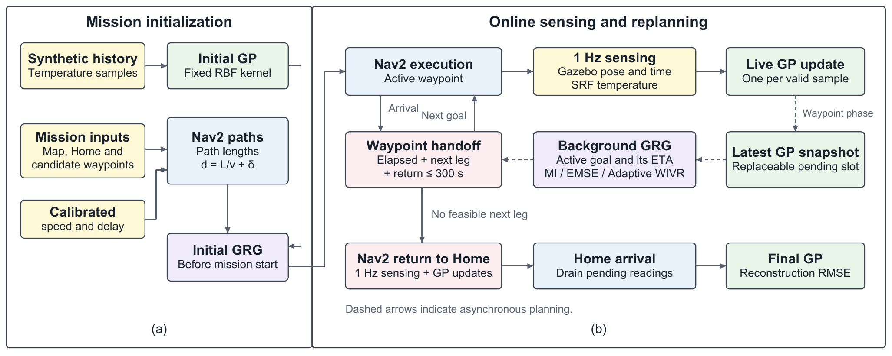
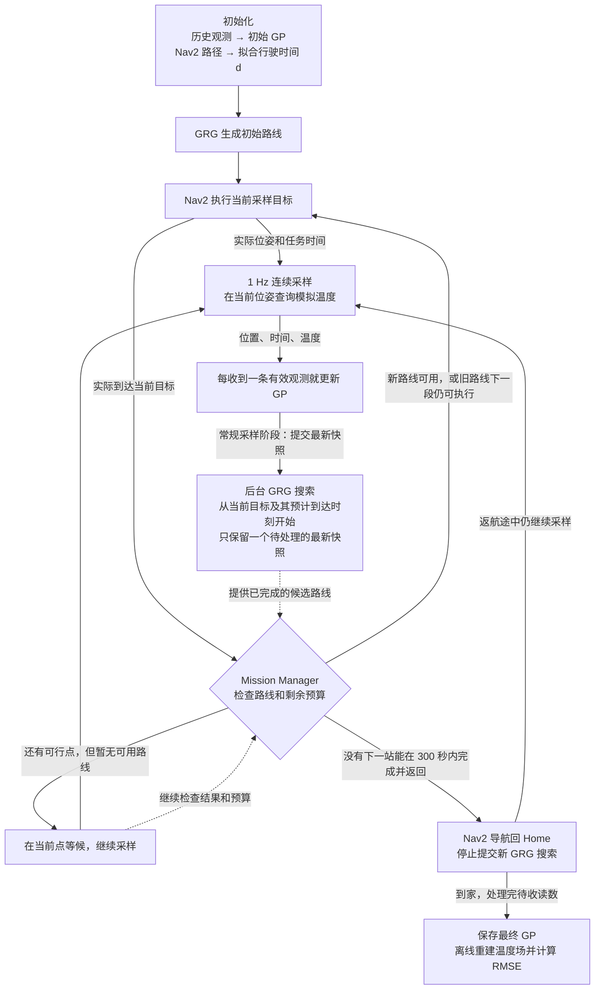

# WELL-E 项目核心逻辑

## 0. 算法的输入与输出

目标是在给定起点、终点和时间预算的条件下，选择一条路线，使沿途预计取得的温度测量对时空场最有价值。算法的输入包括初始观测、时空 GP 模型、可行路径及其时间参数化、采样时钟，以及选定的信息目标。输出包括采样路线、按时返回 Home 的安排，以及加入实际测量后的温度场后验。当前 ROS 目标是 **300 s 内完成从出发到抵达 Home 的任务**，常规导航和返航期间均按 1 Hz 持续采样。

整个计算链可以写成：

$$
\text{已有观测}
\longrightarrow \text{GP 后验}
\longrightarrow \text{候选路线的时空采样事件}
\longrightarrow \text{信息收益}
\longrightarrow \text{GRG 路线搜索}.
$$

执行时，实际观测进入下一次 GP 更新。路线评分所需的是候选测量的时空输入与噪声方差。实际测得的温度值在更新后验均值时才进入计算。

### ROS 2 闭环系统图

#### 论文风格总览

#### 闭环执行流程

## 1. 温度场与离散观测

设 $\mathcal W\subseteq\mathbb R^2$ 为空间区域，$\mathcal T\subseteq\mathbb R$ 为时间区间，重建域为 $\Omega=\mathcal W\times\mathcal T$。用 $T(\mathbf z)$ 表示未知的潜在温度，输入为 $\mathbf z=(x,y,t)^\top\in\Omega$。沿轨迹运动时，传感器在离散时刻取样。若第 $i$ 次测量发生在 $t_i$，轨迹在该时刻的位置为 $(x_i,y_i)$，则模型为

$$
\mathbf z_i=(x_i,y_i,t_i)^\top,\qquad
\widetilde T_i=T(\mathbf z_i)+\epsilon_i,\qquad
\epsilon_i\overset{\mathrm{iid}}{\sim}\mathcal N(0,\sigma_n^2),
\quad \sigma_n^2>0.
$$

假定测量噪声与潜在场独立。因此，观测误差之间独立，潜在温度之间仍可通过 GP kernel 相关。两次独立测量可以拥有相同的输入，此时它们共享该输入处的潜在温度，各自带有独立噪声。以观测身份区分记录，使用 $X=(\mathbf z_i)_{i=1}^N$ 和 $\widetilde{\mathbf T}_X=(\widetilde T_i)_{i=1}^N$ 表示已观测的数据 $\mathcal D$。

## 2. GP 先验、核函数与超参数学习

### 2.1 GP 先验的有限维含义

GP 先验 $T\sim\mathcal{GP}(m,k)$ 的含义是，对任意有限输入列表 $U=(\mathbf u_i)_{i=1}^p$，潜在温度向量 $\mathbf T_U=(T(\mathbf u_i))_{i=1}^p$ 服从联合高斯分布：

$$
\mathbf T_U\sim\mathcal N(\mathbf m_U,K_{UU}),\qquad
[\mathbf m_U]_i=m(\mathbf u_i),\qquad
[K_{UV}]_{ij}=k(\mathbf u_i,\mathbf v_j).
$$

对任意输入 $\mathbf z,\mathbf z'$，$m(\mathbf z)=\mathbb E[T(\mathbf z)]$，$k(\mathbf z,\mathbf z')=\operatorname{Cov}(T(\mathbf z),T(\mathbf z'))$。前者给出条件化前的温度基线，可以取常数 $m_0$。后者给出潜在温度如何共同变化，也确定任意两个输入列表 $U,V$ 之间的交叉协方差矩阵 $K_{UV}$。

### 2.2 三维 ARD RBF kernel

对两个空间坐标和一个时间坐标分别设置长度尺度：

$$
k(\mathbf z,\mathbf z')=
\sigma_f^2\exp\!\left[-\frac12
\left(
\frac{(x-x')^2}{\ell_x^2}+
\frac{(y-y')^2}{\ell_y^2}+
\frac{(t-t')^2}{\ell_t^2}
\right)\right].
$$

$\ell_x,\ell_y,\ell_t>0$ 分别与对应坐标具有相同单位，故指数中的三项均无量纲。若两点只在某一维相差该维的一个长度尺度，先验相关系数为 $e^{-1/2}$。长度尺度越大，固定间隔下相关性越强。$\sigma_f^2>0$ 等于 $k(\mathbf z,\mathbf z)$，是潜在温度的先验方差。$\sigma_n^2$ 来自观测模型，单次含噪观测的先验方差为 $\sigma_f^2+\sigma_n^2$。训练代码沿用 GP-Planning 的空间 ARD RBF 与时间 RBF 相乘的写法。两个指数相乘等于指数内的空间项和时间项相加，正好得到上式。

### 2.3 从初始观测估计超参数

仓库采用常数均值 $m(\mathbf z)=m_0$，以训练集的各输入维度均值和标准差标准化坐标，并对观测温度作同样的变换。本节暂以 $X$ 表示拟合所用的 $N$ 个训练输入。设 $\theta=(m_0,\sigma_f^2,\ell_x,\ell_y,\ell_t,\sigma_n^2)$。根据独立高斯噪声模型，积分消去 $\mathbf T_X$ 与计算两个独立高斯向量的和等价，得到 $\widetilde{\mathbf T}_X\mid X,\theta\sim\mathcal N(\mathbf m_X,C_\theta)$，其中 $C_\theta=K_{XX}+\sigma_n^2 I_N$。令 $\mathbf r=\widetilde{\mathbf T}_X-\mathbf m_X$ 为观测相对先验均值的残差。将高斯密度取自然对数，得到

$$
\log p(\widetilde{\mathbf T}_X\mid X,\theta)=
-\tfrac12\mathbf r^\top C_\theta^{-1}\mathbf r
-\tfrac12\log\det C_\theta-\tfrac N2\log(2\pi).
$$

第一项衡量残差在协方差尺度下的大小，第二项来自高斯密度的归一化因子，第三项只随样本数变化。若 $C_\theta=LL^\top$ 是 Cholesky 分解，解 $L\mathbf b=\mathbf r$ 后即可用 $\mathbf b^\top\mathbf b$ 计算二次型，用 $2\sum_i\log L_{ii}$ 计算对数行列式。训练代码对负边缘对数似然做自动微分，以 Adam 更新均值和受正值约束的 kernel、噪声参数。

把拟合结果转换回物理单位时，各长度尺度乘以对应输入的训练标准差，信号和噪声方差乘以训练温度标准差的平方。均值乘训练温度标准差再加训练温度均值。这些变换使同一个模型可以在物理坐标和温度单位下直接用于路线评分。在线阶段可加载已拟合好的参数，再以初始观测 $\mathcal D_0$ 做条件化。拟合数据负责估计参数，$\mathcal D_0$ 决定规划开始时的后验。后续步骤固定已拟合的参数。

## 3. 从联合高斯推出 GP 后验

取任意查询输入 $U$，并记 $C=K_{XX}+\sigma_n^2 I_N$。独立观测噪声只进入观测块，因此

$$
\begin{bmatrix}\widetilde{\mathbf T}_X\\\mathbf T_U\end{bmatrix}
\sim\mathcal N\!\left(
\begin{bmatrix}\mathbf m_X\\\mathbf m_U\end{bmatrix},
\begin{bmatrix} C&K_{XU}\\K_{UX}&K_{UU}\end{bmatrix}
\right).
$$

把查询温度写成一项由观测线性预测的量和一项剩余量。令 $G=K_{UX}C^{-1}$ 及 $\mathbf e=\mathbf T_U-\mathbf m_U-G(\widetilde{\mathbf T}_X-\mathbf m_X)$。于是 $\operatorname{Cov}(\mathbf e,\widetilde{\mathbf T}_X)=K_{UX}-GC=0$。两者联合高斯，零交叉协方差给出独立性。固定观测值之后，剩余量仍为零均值，其协方差为 $K_{UU}-K_{UX}C^{-1}K_{XU}$。因此，后验均值和任意两个查询列表间的后验协方差为

$$
\begin{aligned}
\boldsymbol\mu_{\mathcal D}(U)
&=\mathbf m_U+K_{UX}C^{-1}(\widetilde{\mathbf T}_X-\mathbf m_X),\\
\Sigma_{\mathcal D}(U,V)
&=K_{UV}-K_{UX}C^{-1}K_{XV}.
\end{aligned}
$$

第二式可由对拼接列表 $(U,V)$ 计算后验再取对应块得到。记 $v_{\mathcal D}(q)=\Sigma_{\mathcal D}(q,q)$。它给出潜在温度的后验方差，$\sqrt{v_{\mathcal D}(q)}$ 是后验标准差。若预测一批新的含噪读数，则其协方差为 $\Sigma_{\mathcal D}(U,U)+\sigma_n^2 I$。

计算时复用 $C=LL^\top$。先解 $L\mathbf b=\widetilde{\mathbf T}_X-\mathbf m_X$，再对查询列表解 $LB_U=K_{XU}$。这样均值是 $\mathbf m_U+B_U^\top\mathbf b$，协方差是 $K_{UV}-B_U^\top B_V$。后验协方差由输入位置、时间和固定超参数决定。后验均值还取决于观测残差。

## 4. 同一批候选测量如何产生三种路线收益

### 4.1 候选事件的条件协方差与方差下降

记 $S=S(P)$ 为候选路线 $P$ 的预计采样事件列表，构造方法见 §5.2。取固定时空评价列表 $Q$。若 $S$ 为空，三种目标的收益均为零。其他情况下，在同一个当前后验下定义

$$
M_S=\Sigma_{\mathcal D}(S,S)+\sigma_n^2 I_{|S|},\qquad
H=\Sigma_{\mathcal D}(Q,S).
$$

$M_S$ 是未来含噪读数的联合协方差，非对角元素表示事件之间的相关性。$H$ 的第 $q,s$ 项表示评价点与候选事件的潜在温度如何共同变化。未来观测噪声独立，故它也等于 $\mathbf T_Q$ 与未来读数 $\widetilde{\mathbf T}_S$ 的条件交叉协方差。

将 §3 的条件高斯公式再用一次，以当前后验为起点，以未来读数为条件。更新后的 $Q$ 上协方差等于当前协方差减去

$$
\Delta_Q(S\mid\mathcal D)=H M_S^{-1}H^\top.
$$

因为 $\sigma_n^2>0$，$M_S$ 正定。令 $M_S=L_SL_S^\top$，解 $L_S Z=H^\top$，便得到 $\Delta_Q=Z^\top Z$。所以每个评价点 $q$ 的方差下降量 $d_q(S)=[\Delta_Q]_{qq}=\sum_j Z_{jq}^2\ge 0$。这个量对所有可能的未来读数都相同，可以在采样前直接算出。

只有一个候选事件 $s$ 时，矩阵式退化为

$$
d_q(\{s\})=
\frac{\Sigma_{\mathcal D}(q,s)^2}{v_{\mathcal D}(s)+\sigma_n^2}.
$$

分子表示事件对目标位置的关联强度，分母是该事件含噪读数的方差。若有多个事件，联合矩阵 $M_S$ 同时处理它们之间的冗余。

### 4.2 MI：沿途测量提供多少联合信息

MI（Mutual Information）衡量未来含噪读数 $\widetilde{\mathbf T}_S$ 对同一批事件上的潜在温度 $\mathbf T_S$ 提供多少信息。由条件互信息定义，

$$
J_{\mathrm{MI}}(S\mid\mathcal D)
=h(\widetilde{\mathbf T}_S\mid\mathcal D)
-h(\widetilde{\mathbf T}_S\mid\mathbf T_S,\mathcal D).
$$

对 $m$ 维高斯向量，微分熵为 $\tfrac12\log((2\pi e)^m\det\Sigma)$。上式第一项的协方差是 $M_S$。给定 $\mathbf T_S$ 后，第二项的协方差只剩 $\sigma_n^2 I_m$，其中 $m=|S|$。相减后公共常数抵消：

$$
J_{\mathrm{MI}}(S\mid\mathcal D)
=\tfrac12\bigl[\log\det M_S-m\log\sigma_n^2\bigr]
=\tfrac12\log\det\!\bigl(I_m+\sigma_n^{-2}\Sigma_{\mathcal D}(S,S)\bigr).
$$

其中 $\sigma_n^{-2}=1/\sigma_n^2$。直接复用 $L_S$ 的对角元素即可计算对数行列式。协方差的每个特征值 $\lambda_j$ 对 MI 贡献 $\tfrac12\log(1+\lambda_j/\sigma_n^2)$，故相关性通过联合矩阵进入评分，收益以 nats 计。

原 GP-Planning 在固定候选节点全集 $V$ 上计算 $I(\widetilde{\mathbf T}_S;\mathbf T_V\mid\mathcal D)$，即观测前后 $\mathbf T_V$ 的熵差。若 $S$ 的潜在输入全都包含在 $V$ 内，则给定 $\mathbf T_V$ 已知 $\mathbf T_S$，读数的条件熵只由独立测量噪声决定，因此两种写法等价。沿边事件可以落在任意位置与时刻，当前 MI 直接使用 $\mathbf T_S$ 作为目标变量。EMSE 和 WIVR 使用固定的评价列表 $Q$。

### 4.3 EMSE：评价域的平均平方误差期望下降多少

对查询点 $q$，任取预测值 $a$。把 $T(q)-a$ 拆成 $T(q)-\mu_{\mathcal D}(q)$ 和 $\mu_{\mathcal D}(q)-a$。展开平方后，由于 $\mathbb E[T(q)-\mu_{\mathcal D}(q)\mid\mathcal D]=0$，交叉项消失，于是

$$
\mathbb E[(T(q)-a)^2\mid\mathcal D]
=v_{\mathcal D}(q)+(\mu_{\mathcal D}(q)-a)^2.
$$

取 $a=\mu_{\mathcal D}(q)$ 可最小化期望平方误差，其最小值为后验方差。采样后使用更新后的后验均值，最小期望平方误差的下降量就是 §4.1 的 $d_q(S)$。

为计算时空域的平均下降量，将空间域划分为有效面积 $a_i>0$ 的单元，用 $\mathbf p_i$ 代表第 $i$ 个单元。在相同的 $L$ 个等间隔评价时刻 $t_\ell^Q$ 上，用 $q_{i\ell}=(\mathbf p_i,t_\ell^Q)$ 构成 $Q$。用代表点近似空间积分，并以等权近似时间平均，得到

$$
J_{\mathrm{EMSE}}(S\mid\mathcal D)
=\frac{\sum_i a_i\sum_{\ell=1}^L d_{q_{i\ell}}(S)}
       {L\sum_i a_i}.
$$

单位面积的重要性相同，边界单元按其有效面积参与平均。若所有单元等面积，该式就是 $\operatorname{tr}(\Delta_Q)/|Q|$。路线搜索最大化 EMSE 的下降量，等价于在同一当前后验与同一评价域下最小化采样后的剩余 EMSE。这里的期望由 GP 后验定义。

GP-Planning 的单事件 EMSE 公式对条件方差下降求和。评价列表固定且等权时，除以评价点数只改变分值的比例。按有效面积加权则对应不同面积单元对空间平均的贡献。

### 4.4 WIVR：带空间重要性的方差下降量

WIVR（Weighted Integrated Variance Reduction）在同一个 $Q$ 上为每个评价点指定非负权重 $w_{i\ell}$。只要权重总和为正，归一化收益就是

$$
J_{\mathrm{WIVR}}(S\mid\mathcal D;w)=
\frac{\sum_{i,\ell} w_{i\ell}\,d_{q_{i\ell}}(S)}
     {\sum_{i,\ell} w_{i\ell}}.
$$

权重加在希望减少误差的评价点上。一个候选事件即使位于低权重区域，也可以通过与高权重区域的后验交叉协方差取得较大的收益。取 $w_{i\ell}=a_i$ 时，公式与 §4.3 的面积平均 EMSE 相同。两种收益都具有温度平方的单位。

GP-Planning 的 WIVR 使用按距池边距离衰减的固定空间权重。Adaptive WIVR 保留同样的加权方差下降结构，在第 $k$ 轮开始时使用当前数据 $\mathcal D_k$ 与权重参考时刻 $t_k$ 计算

$$
u_i^{(k)}=v_{\mathcal D_k}((\mathbf p_i,t_k)),\qquad
w_{i\ell}^{(k)}=a_i u_i^{(k)} \quad (\ell=1,\dots,L).
$$

$u_i^{(k)}$ 是该空间单元的单位面积重要性，乘 $a_i$ 后得到离散积分中的总权重。同一空间单元在各评价时刻共享这个权重，方差下降 $d_{q_{i\ell}}(S)$ 仍通过 GP 随评价时间变化。如果所有 $u_i^{(k)}$ 都低于数值容差，使用 $w_{i\ell}=a_i$。本轮所有候选路线及递归子问题使用同一份权重。实际 GP 更新后可用新后验计算下一轮权重。

### 4.5 条件增益怎样在子路线之间传递

设 $A$ 是已经排入候选前缀的事件，$B$ 是拟追加的事件，两者按事件身份去重。用 $\Sigma_{\mathcal D\mid A}$ 表示对 $A$ 的假设读数作条件化后的协方差。它由 §4.1 的公式算得，所需输入只有事件位置、时间和噪声方差。定义追加收益 $J(B\mid\mathcal D;A)=J(A\cup B\mid\mathcal D)-J(A\mid\mathcal D)$。这个差值可直接用 $\Sigma_{\mathcal D\mid A}$ 给 $B$ 评分。

对 MI，联合熵按链式法则拆成前缀读数的熵与给定前缀后的后缀读数条件熵，独立观测噪声的熵也按批次相加。对 EMSE 和固定权重的 WIVR，采样前后方差之差可先减去前缀更新后的方差，再加上它与最终方差之差，因此逐点相消。三种目标都满足

$$
J(A\cup B\mid\mathcal D)
=J(A\mid\mathcal D)+J(B\mid\mathcal D;A).
$$

这一步让递归搜索按前缀已有的信息评估后缀的新增价值。Adaptive WIVR 在整轮冻结权重，才可使用同一组权重得到上述相消关系。

## 5. 从路径几何到时空采样事件

### 5.1 路线、边代价与预算

设候选 Checkpoints 与 Home 构成顶点集合 $V$，有序路线为 $P=(v_0,\dots,v_M)$。路径规划器为可达的有向边 $(i,j)$ 提供路径折线 $g_{ij}$。对路径顶点 $\mathbf a_0,\ldots,\mathbf a_m$，令 $s_0=0$，逐段计算累计弧长 $s_r=s_{r-1}+\|\mathbf a_r-\mathbf a_{r-1}\|$，末项 $s_m=L_{ij}$ 即路径总长。本轮 ROS 实验采用从 Bunker Mini Gazebo / Nav2 行驶记录得到的统一边代价：

$$
d_{ij}=\frac{L_{ij}}{v}+\delta,\qquad
v=0.891822\,\mathrm{m/s},\quad \delta=2.709215\,\mathrm{s}.
$$

两项参数由 MI、EMSE 与 WIVR 的 113 段仿真导航记录联合最小化平方误差得到；另外 33 段留出记录的 RMSE 为 2.178 s。参数和数据出处见 [行驶时间标定](../Code/Final_Code/Trained_timecost/README.md)。

出发时刻为 $t_0^P$ 时，第 $j$ 个 Checkpoint 的预计到达时刻为 $t_j^P=t_0^P+\sum_{r=1}^j d_{v_{r-1},v_r}$。对末端为 $v_M$ 的常规采样路线，要求 $t_M^P+d_{v_M,h}\le t_{\max}^P$，其中 $h$ 为 Home，任务截止时刻为 300 s。已经在 Home 时无需行驶，$d_{hh}=0$。GRG 在满足该约束的候选中继续按 $J(S(P)\mid\mathcal D)$ 评分，$S(P)$ 只包含常规采样路线的预计事件。返航的实际观测会进入最终 GP。

### 5.2 同一个采样时钟如何跨边运行

固定采样时钟原点 $\phi$ 与间隔 $\Delta_s>0$，全局 tick 为 $\tau_n=\phi+n\Delta_s$。沿每条正耗时边，只取满足 $t_{j-1}^P<\tau_n\le t_j^P$ 且处于采样窗口内的 tick。这样交界时刻只归属于上一段，每轮从规划起点之后的首个 tick 开始，跨边连续使用同一相位。

对某个落在边 $(i,j)$ 上的 tick，把已走时间比例映射为弧长 $\widehat s=L_{ij}(\tau_n-t_{\mathrm{edge}})/d_{ij}$。其中 $t_{\mathrm{edge}}$ 为该边的预计起始时刻。找出包围 $\widehat s$ 的两项 $s_{r-1},s_r$，在对应非零长度线段内插值：

$$
\beta=\frac{\widehat s-s_{r-1}}{s_r-s_{r-1}},\qquad
\widehat{\mathbf p}_P(\tau_n)=(1-\beta)\mathbf a_{r-1}+\beta\mathbf a_r.
$$

最终将 $(\widehat x_P(\tau_n),\widehat y_P(\tau_n),\tau_n)^\top$ 加入 $S(P)$。这个过程为常规采样路线生成评分所需的预计输入。路径形状、预计边耗时和出发时刻都会影响 $S(P)$。执行阶段的采样器按实际位姿与时间戳取得观测，同一 1 Hz 时钟持续到返航完成。GP 输入与预计事件、实际记录、评价时刻共用同一时间基准和单位。

## 6. GRG 如何递归找路线

### 6.1 子问题和预算分割

固定一次搜索的 GP 快照、起始时刻 $t_0^P$、路径图、评分目标和所需权重。递归子问题记为 $\operatorname{Search}(R,g,b,d)$，其中 $R$ 是已经排定的路线前缀，$s=R[-1]$ 是前缀末端，$g$ 是本层目标，$b$ 是到达 $g$ 的截止时刻，$d$ 是剩余递归深度。前缀的完成时刻 $t(R)$ 根据 §5.1 从同一个 $t_0^P$ 累加得到。

先检查直接把 $g$ 接到 $R$ 的路线能否满足 $b$。当前递归以该路线作为可行性入口和基准。当 $d=0$ 时返回基准路线。当 $d=1$ 时，比较直接结束和插入一个可行中间点的路线，保留本层得分最高的可行候选。

当 $d>1$ 时，枚举中间点 $v$，利用两条直达边估计分割时刻的可行区间：

$$
b_{\mathrm{lo}}=t(R)+d_{sv},\qquad
b_{\mathrm{hi}}=b-d_{vg}.
$$

下界是直接从前缀末端到 $v$ 的预计时刻。上界为 $v$ 后至少预留一段直达 $g$ 的时间。若下界超过上界，当前搜索跳过该中间点。其余情况在区间内取 $m$ 个等间隔分割时刻 $b'_j=b_{\mathrm{lo}}+\tfrac{j}{m+1}(b_{\mathrm{hi}}-b_{\mathrm{lo}})$，其中 $j=1,\ldots,m$。对每个 $b'=b'_j$，先计算 $R_1=\operatorname{Search}(R,v,b',d-1)$，再计算 $R_2=\operatorname{Search}(R_1,g,b,d-1)$。第二次调用携带完整的 $R_1$，从 $t(R_1)$ 接续。$b'$ 只约束前段最迟结束的时间。路线事件仍按各边实际分配的预计耗时计算。

### 6.2 前缀条件化如何体现在整条路线的评分中

对某个固定 $R_1$，将所有候选后缀与它拼成整条路线，再按 $J(S(R_2)\mid\mathcal D)$ 比较。§4.5 表明，这个总分等于固定前缀分数加上后缀的条件收益，所以给整条路线联合评分就能实现对后缀的条件比较。连接点在传递前缀时已经存在，后续只追加新边，并在同一时钟上计算该边的事件。

对子路线的选择是贪心的。每个分割先保留一个前段，再用它递归搜索后段，最后将完整路线与直接路线及其他分割的候选比较。根调用以当前位置或当前目标的预计到达位置为起点。Home 是预算约束中的任务终点，搜索仍比较常规采样路线。有限递归深度、分割离散化和前段贪心选择共同限制了搜索空间，因此返回的是近似路线。

在固定的可选事件全集、固定当前 GP 与独立观测噪声下，MI 具有边际收益递减性质：单事件的条件增益为 $\tfrac12\log(1+v_{\mathcal D\mid A}(s)/\sigma_n^2)$，随已条件化的事件集扩大，方差只会减小。EMSE 和固定权重 WIVR 具有单调性，因为各评价点的方差下降非负。一般 GP 的方差降低目标可能出现互补性，单调性本身不足以证明次模性或推出 GRG 的近似保证。分割与递归结构参考 [Binney、Krause 和 Sukhatme, 2013](https://doi.org/10.1177/0278364913488427)。

## 7. 用实际测量批量更新 GP

设当前数据为 $\mathcal D_k$，新到的一批有效观测为 $\mathcal B_k$。记它们的实际输入为 $B$，读数为 $\widetilde{\mathbf T}_B$。定义这批观测的预测误差和含噪协方差：

$$
\mathbf r_B=\widetilde{\mathbf T}_B-\boldsymbol\mu_{\mathcal D_k}(B),\qquad
M_B=\Sigma_{\mathcal D_k}(B,B)+\sigma_n^2 I_{|B|}.
$$

将 §3 的条件高斯公式应用于当前后验，得到

$$
\begin{aligned}
\boldsymbol\mu_{\mathcal D_{k+1}}(U)
&=\boldsymbol\mu_{\mathcal D_k}(U)
+\Sigma_{\mathcal D_k}(U,B)M_B^{-1}\mathbf r_B,\\
\Sigma_{\mathcal D_{k+1}}(U,V)
&=\Sigma_{\mathcal D_k}(U,V)
-\Sigma_{\mathcal D_k}(U,B)M_B^{-1}\Sigma_{\mathcal D_k}(B,V).
\end{aligned}
$$

第一式用新测量相对旧预测的残差修正均值。第二式从当前协方差扣除已取得的信息。固定模型参数和噪声模型时，先后对 $\mathcal D_k$ 和 $\mathcal B_k$ 条件化，等价于将新记录追加到 $\mathcal D_k$ 后一次条件化。仓库的批量更新采用后一种计算方式：拼接实际输入与读数，重新分解加入噪声的训练协方差。以记录身份判断一条读数是否已纳入，保留具有相同输入的独立读数。

## 8. 后验更新与路线更新怎样衔接

系统使用采样时钟取得离散观测。仓库的沿边闭环按配置的间隔触发 GP 更新，将缓冲区内已收到的观测合并为一批，并用更新后的 GP 快照发起搜索。WIVR 的权重参考时刻 $t_k$ 取本批最后一条测量的时刻。如果机器人正向某个目标运动，下一次搜索从该目标及其预计到达时刻 $t_0^P$ 开始。$t_k$ 决定空间权重，$t_0^P$ 决定预计样本的时间安排。

新的候选路线在当前路径段结束后才进入下一段的选择。选用前核对路线是否对应当前目标、是否已有完成的搜索结果，再用实际任务时间检查下一段与返航是否仍能放进预算。若 $t_{\mathrm{now}}$ 为当前实际时刻，拟执行 $s\to v$，则须满足

$$
t_{\mathrm{now}}+d_{sv}+d_{vh}\le 300\,\mathrm{s}.
$$

如果没有满足条件的下一站，就结束 GRG 的目标选择，把 Home 作为唯一目标交给 Nav2。Nav2 根据地图和当前位置规划实际返航路径，采样器继续按 1 Hz 记录温度；到家后将全部有效返航观测纳入最终 GP。以实际任务时钟判断是否在 300 s 内到家，记录超时与返航失败。

## 9. 端到端计算顺序

1. 加载拟合得到的常数均值、RBF 参数和噪声，以初始观测构造 GP 后验及其 Cholesky 分解。
2. 固定当前 GP 快照，读取 Nav2 路径几何、拟合边代价与含返航的剩余任务预算。对 Adaptive WIVR，计算并冻结本轮评价权重。
3. GRG 递归枚举中间点与时间分割。对每条可行候选路线，用同一采样时钟生成 $S(P)$，计算联合事件协方差，再用当前选定目标评分。
4. 启用可执行的路径段，同时缓冲带实际位置、时间与温度的观测。到达 GP 更新触发条件时，批量加入有效读数。
5. 需要重规划时，从更新后的 GP 快照开始步骤 2，并检查下一段和返航是否都能放入剩余预算。没有可行的下一站时，交给 Nav2 返回 Home 并持续采样，到家后将剩余有效观测纳入最终后验。

原方法可对照 [GP-Planning 的 GRG 与 MI](../GP-Planning/src/planners.py) 和 [时空 GP 与方差下降目标](../GP-Planning/notebooks/06_temporal_nonstationary.ipynb)。训练过程见 [GP 模型与拟合代码](../Code/Final_Code/Trained_Real_Data_Kernel/testing_code/gp_model.py)。[沿边搜索核心](../Code/Verification%20tests/WIVR_test/code/src/core.hpp) 提供 MI、EMSE 与 WIVR 三种目标，[闭环调度](../Code/Verification%20tests/WIVR_test/code/src/nodes.cpp) 使用 Adaptive WIVR。

---

## 未来规划

- **改进行驶时间估计。** 尝试使用扩展卡尔曼滤波（EKF）或其他估计方法，结合运行反馈在线估计行驶状态，据此更新 GRG 的边代价 $d_{ij}$。
- **接入 Nav2 实时路径。** 当前系统把实时位姿投影到任务开始前构建或加载的固定路径折线，以估算到当前目标的剩余距离和到达时间。Nav2 在执行中重新规划的路径尚未用于这项估算。未来可读取与当前目标匹配的最新 Nav2 路径，在路径变化时重新计算剩余弧长和预计到达时刻，并将更新后的导航状态传给下一轮 GRG。
- **比较路径规划算法。** 在相同地图、采样规则和任务预算下，比较 GRG 与其他规划算法的温度场重建误差和计算开销。
- **尝试其他 GP 核函数与外推。** 比较不同核函数在观测时间范围之外预测温度的效果。
