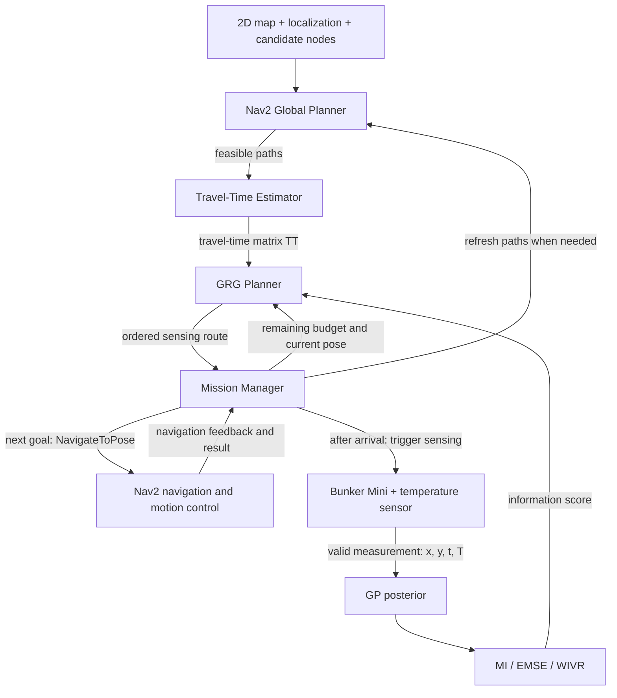

# WELL-E 项目核心逻辑

> 目标：GP 表示时空温度场，MI、EMSE 或 WIVR 评价采样价值，Greedy Recursive Growth（GRG）选择预算内的采样位置与顺序。Nav2 在规划前提供可行路径，供 Travel-Time Estimator 估算行驶时间；在规划后执行下一 waypoint。Mission Manager 协调导航、采样、GP 更新、预算管理和滚动重规划。

## 0. 系统总流程与反馈关系

GP 提供温度估计、后验不确定性和相关性；评分函数量化候选采样价值；GRG 决定去哪采样及访问顺序。Nav2 的全局规划器提供可行路径，局部控制器产生运动指令，并反馈执行状态。Mission Manager 串联这些模块，决定何时采样、何时重规划以及何时返航。

温度传感器产生测量，定位系统提供实际位姿，任务时钟提供时间戳；GP 和 GRG 均不直接控制电机。第 10 节计划在 ROS 2 + Gazebo 中运行 Bunker Mini 的 GP–GRG–Nav2 闭环，温度由满足时空获取条件的记录数据提供。它是待实现和验证的 ROS 2 仿真实验，不代表实体机器人实验已经完成。

---

## 1. 温度场与离散含噪观测

未知温度场写为

$$
f:\mathbb R^3\rightarrow\mathbb R,
\qquad
T=f(x,y,t),
$$

并定义时空输入

$$
\mathbf z=[x,y,t]^\top.
$$

机器人或历史传感器只能得到有限的离散观测：

$$
\mathcal D=\{(\mathbf z_i,y_i)\}_{i=1}^{N},
\qquad
y_i=f(\mathbf z_i)+\epsilon_i,
\qquad
\epsilon_i\sim\mathcal N(0,\sigma_n^2).
$$

- $f(\mathbf z_i)$ 是潜在的真实温度；
- $y_i$ 是含测量噪声的观测；
- $\sigma_n^2$ 是观测噪声方差。

研究问题不是只拟合已经测过的点，而是用 $\mathcal D$ 推断连续温度场，并主动选择下一批最有信息价值的采样事件。

## 2. GP 先验与 3D ARD RBF Kernel

对未知函数设置 GP 先验：

$$
f(\mathbf z)\sim
\mathcal{GP}\!\left(m(\mathbf z),k(\mathbf z,\mathbf z')\right).
$$

WELL-E 使用的三维 ARD RBF kernel 为

$$
\boxed{
k(\mathbf z,\mathbf z')=
\sigma_f^2
\exp\!\left[
-\frac12\left(
\frac{(x-x')^2}{\ell_x^2}
+\frac{(y-y')^2}{\ell_y^2}
+\frac{(t-t')^2}{\ell_t^2}
\right)
\right]
}
$$

其超参数可记为

$$
\boldsymbol\theta=
\{\sigma_f^2,\ell_x,\ell_y,\ell_t,\sigma_n^2\}.
$$

- $\sigma_f^2$ 控制潜在温度场的信号方差；
- $\ell_x,\ell_y,\ell_t$ 分别控制两个空间方向和时间方向的相关尺度；
- ARD 允许三个方向具有不同变化速率。

Kernel 的关键含义是

$$
k(\mathbf z,\mathbf z')
=\operatorname{Cov}\!\left(f(\mathbf z),f(\mathbf z')\right).
$$

因此，它不仅决定某个测量如何影响邻近位置的预测均值，也决定测量后其他位置的不确定性下降多少。它还是后续 MI 的基础：两个高度相关的采样点通常存在信息冗余。

GP conditioning 与超参数学习是两个步骤：固定 $\boldsymbol\theta$ 时，新观测通过后验公式更新预测；若需要重新学习相关尺度和噪声参数，则另行优化 $\boldsymbol\theta$。

## 3. GP 后验均值与协方差

令训练输入为 $X=[\mathbf z_1,\ldots,\mathbf z_N]^\top$，观测向量为 $\mathbf y$，查询集合为 $Z_*$。定义

$$
C=K_{XX}+\sigma_n^2I.
$$

GP conditioning 给出潜在温度场的后验均值：

$$
\boxed{
\boldsymbol\mu_*
=\mathbf m_*+K_{*X}C^{-1}(\mathbf y-\mathbf m_X)
}
$$

以及后验协方差：

$$
\boxed{
\Sigma_*
=K_{**}-K_{*X}C^{-1}K_{X*}
}
$$

即

$$
f(Z_*)\mid\mathcal D
\sim\mathcal N(\boldsymbol\mu_*,\Sigma_*).
$$

这里 $\operatorname{diag}(\Sigma_*)$ 是**潜在温度场**的 posterior variance；未来含噪观测的 predictive covariance 则为 $\Sigma_*+\sigma_n^2I$。固定时间 $t$ 后，$\mu(x,y,t)$ 形成预测温度图，$\sigma^2(x,y,t)$ 形成不确定性图。

实际计算中应通过 Cholesky 分解或线性方程求解实现上述表达式，而不是显式构造 $C^{-1}$。

## 4. 路线评分：MI、EMSE 与 WIVR

三种目标共用 GP 后验协方差，区别在于如何衡量一次采样对任务的价值：MI 看联合信息量，EMSE 看全场平均预测误差的模型期望，WIVR 在方差降低上加入区域重要性权重。它们可以作为 GRG 的不同路线评分函数，每次规划选择其中一种。

### 4.1 路线对应采样事件

候选高层路线写为

$$
P=[v_0,v_1,\ldots,v_M].
$$

路线不只决定“去哪些空间节点”，还通过移动、等待和驻留时间决定“何时测量”。因此对应的采样事件集合是

$$
S(P)=\{\mathbf z_i^P\}_{i=1}^{M},
\qquad
\mathbf z_i^P=(x_{v_i},y_{v_i},t_i^P).
$$

规划阶段的 $t_i^P$ 根据预计行驶、等待和传感时间计算；Nav2 路径改变会影响行驶时间估计，从而影响时空采样价值。执行后加入 GP 的输入必须使用实际测量位姿和时间戳，而不是直接沿用计划事件。

给定当前数据 $\mathcal D$，先在这些事件上计算潜在温度的 GP posterior covariance：

$$
\Sigma_{SS\mid\mathcal D}
=K_{SS}-K_{SX}
(K_{XX}+\sigma_n^2I)^{-1}K_{XS}.
$$

固定 kernel 和噪声参数时，这个协方差取决于已有测量的位置、时间与候选事件，不依赖未来测量值。因此可以在机器人出发前计算候选路线收益；实际测量值则用于更新预测均值。

### 4.2 MI：最大化联合信息增益

MI（Mutual Information，互信息）衡量测量前后不确定性的熵差。采样事件的联合条件互信息可写为：

$$
\boxed{
J(P\mid\mathcal D)
=I\!\left(
\mathbf y_{S(P)};
\mathbf f_{S(P)}\mid\mathcal D
\right)
=\frac12\log\det\!\left(
I+\frac{1}{\sigma_n^2}
\Sigma_{S(P)S(P)\mid\mathcal D}
\right)
}
$$

其中 $\mathbf y_S$ 是未来含噪观测，$\mathbf f_S$ 是相同事件上的潜在真实场。MI 同时考虑事件自身的不确定性，以及多个事件之间的相关性：两个高度相关的点即使各自方差很大，联合收益也会因信息冗余而折减。时空模型中，路线影响到达时间，所以同一空间节点在不同时间可以具有不同价值。

若 $\lambda_j$ 是 $\Sigma_{SS\mid\mathcal D}$ 的特征值，则

$$
J(P\mid\mathcal D)
=\frac12\sum_j
\log\!\left(1+\frac{\lambda_j}{\sigma_n^2}\right).
$$

这说明 MI 累计的是各个相关模式的信息增益，不能用各点方差的简单求和替代。

GP-Planning 的 `src/planners.py::gp_mutual_information` 将目标写成全候选场 $V$ 的熵降低。给定已承诺观测集合 $C$，新增采样集合 $A$ 的收益为：

$$
\boxed{
F_{\mathrm{MI}}(A\mid C)
=I(\mathbf y_A;\mathbf f_V\mid\mathbf y_C)
=\frac12\left[
\log\det\Sigma_{V\mid C}
-\log\det\Sigma_{V\mid C\cup A}
\right]
}
$$

当 $A\subseteq V$、kernel 与独立观测噪声一致时，这与采样点上的 $\frac12\log\det(I+\sigma_n^{-2}\Sigma_{AA\mid C})$ 理论等价；代码中的 jitter 会产生数值近似差异。静态节点规划按集合评分，同一集合的顺序不改变 MI，但会改变旅行时间；时空事件规划还需根据路线重新计算采样时间。

### 4.3 EMSE：降低全场平均预测方差

EMSE（Expected Mean Squared Error，期望均方误差）以 GP 后验均值作为预测。模型成立时，对潜在场 $f(v)$ 有：

$$
\mathbb E\!\left[(f(v)-\mu(v))^2\mid\mathcal D\right]
=\sigma^2(v\mid\mathcal D).
$$

这直接来自方差的定义：以分布的均值作为估计，其期望平方误差就是方差。例如 $T(A)\mid\mathcal D\sim\mathcal N(20,0.5^2)$，取 $20\,{}^{\circ}\mathrm{C}$ 为估计，则预期平方误差为 $0.25\,({}^{\circ}\mathrm{C})^2$；某次真实温度对应的实际平方误差仍取决于真实值。这一等式在 GP 后验分布内成立；它是否准确反映真实误差，取决于模型是否符合实际。

因此，在固定评价集合 $V$ 上，平均后验方差就是模型内的 EMSE：

$$
\operatorname{EMSE}(C)
=\frac1{|V|}\operatorname{tr}(\Sigma_{V\mid C}).
$$

规划最大化加入 $A$ 后的降低量：

$$
\boxed{
F_{\mathrm{EMSE}}(A\mid C)
=\frac1{|V|}\operatorname{tr}\!\left(
\Sigma_{V\mid C}-\Sigma_{V\mid C\cup A}
\right)
}
$$

例如，三个评价位置的方差从 $(1,2,3)$ 降为采样后的 $(0.1,1.5,2.8)$，则平均方差从 $2$ 降为约 $1.467$，该采样方案的 EMSE 收益为 $0.533\,({}^{\circ}\mathrm{C})^2$。固定 kernel 时，方差更新不需要未来温度值，因此 GRG 可以提前比较各条可行路线的预期收益。方差降低表示模型认为误差会减小，实际 held-out RMSE 是否改善仍需真实数据验证。

单点收益最容易看出选点逻辑。设 $B$ 为已有观测集合，$j$ 为候选采样点，定义：

$$
c_{vj\mid B}
=K_{vj}-K_{vB}(K_{BB}+\sigma_n^2I)^{-1}K_{Bj},
\qquad
s_{j\mid B}
=K_{jj}+\sigma_n^2-K_{jB}(K_{BB}+\sigma_n^2I)^{-1}K_{Bj}.
$$

测量 $j$ 后，评价位置 $v$ 的潜在方差下降量为：

$$
\Delta\sigma_v^2(j\mid B)
=\frac{c_{vj\mid B}^2}{s_{j\mid B}},
\qquad
\Delta_{\mathrm{EMSE}}(j\mid B)
=\frac1{|V|}\sum_{v\in V}\frac{c_{vj\mid B}^2}{s_{j\mid B}}.
$$

候选点不仅要自身不确定，还要与许多评价位置保持较强的条件相关性，才能有效降低全场误差。分母包含观测噪声，噪声越大，同一次采样带来的方差降低越小。

Notebook 06 的 `emse_gain` 使用方差降低量之和，省略固定常数 $1/|V|$，不影响同一次规划内的排序。`emse_obj` 逐点加入集合并累计条件收益，等价于整条路线的总方差降低。指标表中的 EMSE 是剩余平均方差，越低越好；规划使用的是 EMSE 降低量，越高越好。

### 4.4 WIVR：优先降低重点区域的不确定性

WIVR（Weighted Integrated Variance Reduction，加权积分方差降低）给每个评价位置设置非负权重 $w(v)$。在离散评价集合上：

$$
\boxed{
F_{\mathrm{WIVR}}(A\mid C)
=\sum_{v\in V}w(v)
\left[\sigma^2(v\mid C)-\sigma^2(v\mid C\cup A)\right]
}
$$

对应的单点收益为：

$$
\Delta_{\mathrm{WIVR}}(j\mid B)
=\sum_{v\in V}w(v)\frac{c_{vj\mid B}^2}{s_{j\mid B}}.
$$

所有权重相同时，它与 EMSE 降低量只差固定比例。Notebook 06 针对池塘边缘设置：

$$
w(v)=\exp\!\left(-\frac{d_{\mathrm{edge}}(v)}{8\,\mathrm m}\right).
$$

池边的权重接近 1，距离 8 m 时约为 0.37，距离 16 m 时约为 0.14。权重加在被改善的评价位置 $v$ 上，因此机器人会偏好能降低池边不确定性的采样点；采样点本身不一定就在池边。

WIVR 与 Gibbs kernel 分别表达两件事：Gibbs kernel 用池边较短、高地较长的 lengthscale 描述空间相关性；WIVR 表达池边区域的任务重要性。这里的池边权重是仓库土壤含水量场景的示例；温度重建任务的权重应根据其关注区域定义。

### 4.5 接入 GRG 与滚动重规划

| 评分函数    | 衡量什么                    | 规划偏好                         |
| ----------- | --------------------------- | -------------------------------- |
| MI          | 联合熵降低，使用 $\log\det$ | 信息丰富且冗余较少的采样集合     |
| EMSE 降低量 | 全场后验方差的平均下降      | 能改善较多评价位置预测的采样集合 |
| WIVR        | 重点区域的加权方差下降      | 能改善高权重区域预测的采样集合   |

三者使用同一框架：GP 提供协方差，目标函数评价路线，GRG 结合行驶时间估计和预算搜索；Mission Manager 将下一 waypoint 交给 Nav2，成功到达并取得有效测量后更新 GP，再触发 GRG 重规划。路线长度、返回基地等约束不因评分函数改变；Nav2 不计算 MI、EMSE 或 WIVR，也不根据 GP 不确定性选择采样地点。

实现时，每条候选路线必须使用相同的评价集合、目标时刻和权重。时空场应把评价位置写成 $(x_v,y_v,t_v)$，把候选测量写成实际到达事件 $(x_j,y_j,t_j)$；这样比较的是对同一目标场的改善。

### 4.6 仓库实现与结论边界

- `src/planners.py` 默认使用 MI，并提供 `objective_fn` 接口；Notebook 06 通过 `emse_obj`、`wivr_obj` 接入另外两种目标。不过当前递归调用未继续传入 `objective_fn`，子问题仍回到默认 MI，且共享缓存没有区分目标。因此现有接口尚不能视为完整的纯 EMSE/WIVR 递归优化实现。
- 单独比较 MI、EMSE 与 WIVR 时，应固定 kernel、预算和评价条件，避免把模型差异归因于目标函数。
- 方差降低具有单调性，但一般 GP 下不保证次模；使用 GRG 的理论近似保证前，需要确认对应目标满足其假设，有限随机检查不能代替证明。
- MI 增加、EMSE 或加权方差降低，都属于模型内收益。固定 kernel 与真实场不匹配时，held-out RMSE 仍可能变差；三种规划目标都应与真实预测误差分开报告。

代码对应：`src/planners.py::gp_mutual_information/grg_plan`；`notebooks/06_temporal_nonstationary.ipynb` 中的 `_schur`、`emse_gain`、`wivr_gain`、`emse_obj`、`wivr_obj` 和 `rh_grg_generic`。

## 5. GRG：时间预算内的高层路线优化

设候选节点集合为 $V$，旅行时间矩阵为

$$
TT=[tt_{ij}],
\qquad
tt_{ij}=\text{从节点 }v_i\text{ 到 }v_j\text{ 的估计旅行时间}.
$$

ROS 2 目标架构中，$TT$ 的生成链为：Nav2 Global Planner 输出可行路径 $\pi_{ij}$，独立的 Travel-Time Estimator 根据路径长度和机器人运动假设估算 $tt_{ij}$，再将矩阵提供给 GRG。最简单的近似是 $tt_{ij}\approx L(\pi_{ij})/v_{\mathrm{nom}}$，实际估计应考虑所采用的运动模型。等待和传感驻留时间另计，避免重复计费。

Nav2 提供路径及执行反馈，不直接给出精确行驶时间。矩阵可预计算并缓存，在当前位姿、地图或路径可达性变化时更新相关项。本文使用 $TT$，对应 Nav2 架构说明中的 Travel-Time Matrix $C$，以免与第 3 节 GP 的观测协方差矩阵 $C$ 混淆。

对路线 $P=[v_0,\ldots,v_M]$，任务时间可写为

$$
T_{\mathrm{mission}}(P)
=T_{\mathrm{travel}}(P)
+T_{\mathrm{waiting}}(P)
+T_{\mathrm{dwell}}(P)
+T_{\mathrm{computation}}(P),
$$

其中

$$
T_{\mathrm{travel}}(P)
=\sum_{i=0}^{M-1}tt_{v_i v_{i+1}}.
$$

规划问题是

$$
\boxed{
P^*\approx
\arg\max_{P\in\mathcal P}
J(P\mid\mathcal D)
\quad
\text{s.t.}\quad
T_{\mathrm{mission}}(P)\le T_{\max}
}
$$

若任务要求返回终点或基地 $g$，可行路线还必须满足 $v_M=g$。GRG 用候选中间节点 $v$ 和时间预算拆分递归构造路线：

$$
P_{s\rightarrow g}
=P_{s\rightarrow v}\oplus P_{v\rightarrow g},
\qquad
B_1+B_2\le B
$$

若 $B_1$、$B_2$ 分别表示两段完整子路线的预算，应满足 $B_1+B_2\leq B$，各段旅行、等待和驻留成本计入对应子路线，不再重复扣除。GRG 是近似组合优化方法，输出有序测量 waypoint/事件；具体导航路径与运动执行由 Nav2 完成。

## 6. Nav2 的双向作用与组件职责

### 6.1 规划前：提供可行路径，支持时间估计

系统取得二维地图、定位位姿和候选采样点后，由 Nav2 Global Planner 计算相关位置之间的可行路径。Travel-Time Estimator 将路径转换成 $TT$，GRG 再结合信息评分和剩余预算选择采样路线。

这里只更新受当前位姿、地图或可达性变化影响的路径与时间项，无需每次 GP 更新都重算整张矩阵。定位由独立配置的定位系统提供，例如 AMCL 或其他状态估计方案。

### 6.2 规划后：执行下一 waypoint，并返回状态

Mission Manager 从 GRG 路线中取出下一采样 waypoint，通过 `NavigateToPose` 发送给 Nav2。Nav2 Global Planner 计算到该目标的路径，Local Controller 根据路径、当前位姿及 costmap 产生速度指令，驱动 Bunker Mini，并使用已配置的避障和恢复能力处理导航过程中的障碍。

Nav2 持续返回导航反馈和最终结果。成功到达只表示导航目标完成；等待、温度采集、质量检查和 GP 更新由 Mission Manager 协调，不能仅凭导航成功就视为已经获得有效温度记录。

### 6.3 两种重规划：改变目的地与改变到达路径

| 层级 | 触发条件 | 重新决定的内容 | 输出 |
| --- | --- | --- | --- |
| GRG 任务层重规划 | GP 更新、预算变化、目标不可达或行驶代价改变 | 接下来去哪采样、按什么顺序访问、是否返航 | 新采样路线或下一 waypoint |
| Nav2 导航层重规划 | 障碍或导航环境变化 | 如何到达当前已指定目标 | 同一目标的更新路径与运动指令，或失败结果 |

Nav2 可为同一目标寻找替代路径；改变采样目的地需要由 Mission Manager 触发 GRG 决策。若路径变化显著影响到达时间或返航预算，应更新相关旅行时间，并重新检查任务层可行性。

### 6.4 职责与接口汇总

| 组件 | 主要职责 | 输出或交互对象 |
| --- | --- | --- |
| GP | 表示时空温度场及不确定性 | Posterior mean、covariance/variance |
| MI / EMSE / WIVR | 评价候选采样事件或路线 | 给 GRG 的收益评分 |
| GRG | 在预算内选择采样位置和访问顺序 | 给 Mission Manager 的有序 waypoint |
| Nav2 Global Planner | 根据地图和位姿规划可行路径 | 路径，供时间估计或导航执行使用 |
| Travel-Time Estimator | 根据路径和运动假设估算行驶代价 | 给 GRG 的 $TT$ 及更新项 |
| Nav2 Local Controller | 跟踪路径、产生速度指令并结合 costmap 避障 | 机器人运动指令 |
| 定位系统 | 估计机器人当前位置与朝向 | 给 Nav2 和 Mission Manager 的位姿 |
| 温度传感器 | 采集温度 | 与实际位姿、时间戳对齐的 $(x,y,t,T)$ |
| Mission Manager | 管理导航目标、状态、采样、预算、GP 更新、重规划和返航 | 闭环任务状态及各模块调用 |

## 7. 传感、GP 更新与滚动时域重规划

### 7.1 到达、采样与模型更新

Mission Manager 收到 Nav2 到达成功的结果后，按采样规则执行等待和传感驻留，取得温度并关联实际定位位姿与时间戳。通过质量检查的测量才进入数据集：

$$
\boxed{
\mathcal D_{k+1}
=\mathcal D_k\cup
\{(\mathbf z_{k+1},y_{k+1})\}
}
$$

在固定 kernel 超参数的设置下，重新 conditioning：

$$
(\mu_k,\Sigma_k)
\longrightarrow
(\mu_{k+1},\Sigma_{k+1}).
$$

Mission Manager 根据实际已用时间更新剩余预算，必要时刷新 $TT$，再从当前机器人位置和时刻触发 GRG：

$$
\boxed{
P_{k+1}^*\approx
\arg\max_{P\in\mathcal P_{k+1}}
J(P\mid\mathcal D_{k+1})
\quad
\text{s.t.}\quad
T(P)\le T_{\mathrm{remaining}}
}
$$

GRG 输出新路线后，Mission Manager 只发送下一 waypoint 给 Nav2，并持续监视执行反馈。这就是 receding-horizon informative path planning：每次按当前信息执行一段，再更新模型、时间和路线。

### 7.2 完整闭环与异常分支

1. **初始化：** 加载地图、候选点、Initial GP、Home 和任务时间预算，取得有效定位。
2. **建立代价：** Nav2 Global Planner 生成相关可行路径，Travel-Time Estimator 计算或更新 $TT$。
3. **任务规划：** GRG 根据 GP 评分、当前位姿和剩余预算选择可行采样路线，并预留返回 Home 的时间。
4. **导航执行：** Mission Manager 通过 `NavigateToPose` 发送下一 waypoint；Nav2 规划、控制、避障并返回反馈。
5. **有效采样：** 到达后获取实际 $(x,y,t,T)$，完成质量检查，再更新 GP。
6. **滚动决策：** 更新已用时间、位姿和相关行驶代价，重新检查返航可行性，随后继续采样或向 Nav2 发送 Home 目标。

导航失败、超时或取消时，不产生虚构的温度观测。Mission Manager 处理导航状态、刷新相关路径代价或可达候选点，再决定重试、触发 GRG 重规划或返航。传感失败时同样不更新 GP，但仍需扣除实际消耗的任务时间。返航也由 Nav2 执行，以到达 Home 的结果确认完成，而不是仅以“已发送返航目标”结束任务。

第 10 节将由 Nav2 在 Gazebo 中实际执行导航，并以到达状态、实际定位位姿和模拟任务时间判断记录是否可获取。温度采集模块只从 Acquisition Pool 返回有效匹配的记录；Hidden Test Set 始终隔离。900 秒预算和每点 1 秒采样使用共同模拟任务时钟，真实墙钟耗时另外记录。

## 8. 评价指标及其解释

### 8.1 GP 预测质量

对 held-out 集合 $\{(\mathbf z_j,y_j)\}_{j=1}^{N_*}$：

$$
\operatorname{RMSE}
=\sqrt{
\frac1{N_*}
\sum_{j=1}^{N_*}
(\mu(\mathbf z_j)-y_j)^2
},
$$

$$
\operatorname{MAE}
=\frac1{N_*}
\sum_{j=1}^{N_*}
\left|\mu(\mathbf z_j)-y_j\right|.
$$

若报告 95% predictive interval coverage，必须说明区间针对潜在 $f$ 还是含噪观测 $y$；二者方差分别使用 $\sigma_f^2(\mathbf z)$ 与 $\sigma_f^2(\mathbf z)+\sigma_n^2$。

### 8.2 信息与规划质量

- 路线评分：MI（nats）、EMSE 降低量或 WIVR，分别按其定义报告；
- latent posterior variance 的前后变化；
- 有效测量数量、重复/无效测量数量；
- GRG planning time、递归深度、可行返回；
- $TT$ 更新耗时、缓存复用情况和不可达路径处理；
- 任务时间预算的使用情况。

### 8.3 导航与系统质量

- waypoint/navigation success rate，以及失败、超时或取消后的处理结果；
- 实际 travel time 与 $tt_{ij}$ 估计误差；
- 碰撞/恢复次数；
- 是否在预算内安全返回；
- 定位与测量时间戳对齐、有效采样率；
- 端到端 sensing-to-replanning latency 和 Mission Manager 的任务状态转换。

---

## 9. 最终逻辑

Nav2 在任务规划前后分别参与两条链。规划前，它提供路径，独立估计器将路径转换为 GRG 使用的行驶时间：

$$
\text{Map/Pose}
\xrightarrow{\text{Nav2 Global Planner}}
\pi_{ij}
\xrightarrow{\text{Travel-Time Estimator}}
TT
\xrightarrow{\text{GRG}}
P_k^*.
$$

规划后，Mission Manager 将下一 waypoint 交给 Nav2，收到到达结果后协调采样和 GP 更新：

$$
P_k^*
\xrightarrow{\text{Mission Manager}}
v_{\mathrm{next}}
\xrightarrow{\text{Nav2}}
\text{Arrival}
\xrightarrow{\text{Sensing/Validation}}
(\mathbf z_{k+1},y_{k+1}).
$$

有效测量更新 GP，执行反馈更新位姿、剩余预算和相关行驶时间，两者共同影响下一轮 GRG。GP 表示环境，评分函数定义采样价值，GRG 决定目的地，Nav2 规划并执行到达路径，Mission Manager 组织整个闭环。系统评价分别报告模型内收益、真实重建误差、规划代价和导航表现。

---

## 10. 未来规划实验

# Experiment Plan: ROS 2-Based Comparison of MI, EMSE, and WIVR for Informative Robotic Sampling

Repository:
https://github.com/Albert-Ludwig/4RP3_ARCO_Lab_Research

## 1. Research Objective

The objective of this experiment is to integrate GP regression, Greedy Recursive Growth (GRG), and ROS 2 Nav2 into an autonomous temperature-sampling system in Gazebo, and evaluate how MI, EMSE, and WIVR affect spatiotemporal temperature field reconstruction. The primary evaluation metric is reconstruction RMSE on an independent hidden test dataset.

Establish a functioning MI-based GP–GRG–Nav2 baseline first. Then compare EMSE and WIVR by replacing only the information-scoring objective, while keeping the GP, GRG configuration, robot, navigation environment, and evaluation protocol the same. Include History Only as the no-new-measurement baseline.

The experiment must also document the complete computational implementation: repository paths, Python files and functions, mathematical principles, inputs and outputs, and exchanges between GP, GRG, Nav2, and the Mission Manager. Implementation, tests, and results remain planned until demonstrated by runnable code and saved outputs.

We use an existing three-dimensional Gaussian Process (GP) with a spatiotemporal RBF kernel:

- Input: `z = (x, y, t)`
- Output: temperature `T`
- GP prediction: posterior mean and variance

The reconstruction domain is defined as:

$$
\Omega = \mathcal{W}_{\mathrm{map}} \times [t_{\mathrm{start}},t_{\mathrm{end}}]
$$

where:

- `W_map` is a predefined bounded spatial region obtained from the 2D map.
- `[t_start, t_end]` represents the measurement interval.
- The GP should be able to estimate temperatures at unobserved `(x,y,t)` inputs within this domain.
- The spatial region is fixed and must **not** be defined by the convex hull of the robot's collected measurements.
- We are not investigating future temperature forecasting in this experiment.

The main research question is:

**Under the same ROS 2 robotic navigation conditions and a fixed 900-second mission budget, which GRG scoring policy—MI, EMSE, or WIVR—produces the most accurate reconstruction of unobserved spatiotemporal temperature measurements?**

## 2. Dataset Arrangement

We expect to have five temperature datasets in total:

- Dataset 0: previously collected historical dataset.
- Datasets 1–3: three newly collected datasets.
- Dataset 4: the fourth newly collected dataset, reserved for recorded-data acquisition and reconstruction evaluation during ROS 2/Gazebo missions.

The first four datasets (Dataset 0 + Datasets 1–3) will be used to train the Initial GP.

Dataset 4 must not be used to train the Initial GP, select kernel hyperparameters, or fit normalization parameters.

Its purpose is to supply recorded temperature observations to a new ROS 2/Gazebo robotic sampling session. The records supply temperature data; Nav2 and Gazebo execute the navigation and robot motion.

All measurements have the form:

`(x, y, t, T)`

Preserve their actual spatial coordinates, timestamps, and temperature values. Do not artificially merge different collection dates into a single time interval.

## 3. Hidden Test Records and Candidate Measurements

Before the simulated mission begins, divide Dataset 4 into two disjoint groups.

### A. Acquisition Pool

These are measurements that the simulated Bunker Mini is allowed to acquire.

The GP–GRG planner selects sensing locations according to its scoring policy. The Mission Manager sends the next goal to Nav2, the simulated robot navigates to it in Gazebo, and the acquisition module releases a corresponding available temperature record only after valid spatial and temporal acquisition conditions and the 1-second sensing dwell have been satisfied.

After successful acquisition:

1. Add the actual `(x,y,t,T)` measurement to the GP conditioning dataset.
2. Update the GP posterior.
3. Replan using GRG and the remaining mission time budget.

### B. Hidden Test Set

Randomly select and completely withhold a subset of the actual `(x,y,t,T)` records from Dataset 4.

These records are treated as unknown measurements during the entire experiment.

Important requirements:

- Hidden temperature values must never be used for GP training, acquisition, online updates, or route planning.
- Hidden records must be excluded from the acquisition pool.
- The planner must not use the hidden-record distribution to construct or tune its scoring objectives.
- The original hidden temperatures remain available only for final evaluation.
- The test inputs must lie within the predefined spatial domain and the relevant measurement time interval.

**Important clarification:** We are hiding individual spatiotemporal measurement records, not necessarily entire spatial locations.

It is acceptable for historical datasets to contain measurements at the same `(x,y)` coordinates as a hidden test record, provided they are different observations from earlier datasets.

This experiment primarily evaluates reconstruction at unobserved spatiotemporal inputs, not necessarily spatial locations that have never been measured historically.

Use a fixed, reproducible random seed and preserve the exact train/acquisition/test split.

## 4. ROS 2, Gazebo, and Nav2 Closed-Loop Sampling

Reuse the existing GP regression, GRG optimization, numerical objectives, and data-handling code wherever possible, and connect them to a ROS 2 Mission Manager and Nav2. The primary experiment must execute Bunker Mini navigation in Gazebo; a Python route replay may support debugging but does not substitute for the integrated experiment.

**Runtime responsibilities and interfaces**

| Component | Responsibility | Output / interface |
|---|---|---|
| GP | Represent temperature and correlated uncertainty from acquired data | Posterior mean and covariance for scoring and reconstruction |
| MI / EMSE / WIVR | Evaluate candidate sensing events | Route information score for GRG |
| Nav2 Global Planner | Compute feasible paths on the map | Paths for travel-time estimation and navigation |
| Travel-Time Estimator | Convert paths and robot motion assumptions into travel-time estimates | Cached Travel-Time Matrix `TT = [tt_ij]` |
| GRG | Select informative sensing locations and visit order under the remaining budget | Ordered sensing route |
| Mission Manager | Coordinate goals, feedback, acquisition, GP updates, replanning, and return | ROS 2 task execution and mission state |
| Nav2 navigation | Plan and follow paths with configured obstacle avoidance and recovery | Robot motion, navigation feedback, and goal result |
| Localization | Supply the simulated robot's actual estimated pose | Pose used for navigation and acquisition validation |
| Temperature acquisition module | Check pose/time eligibility and perform the 1-second dwell | Valid Acquisition Pool record `(x,y,t,T)`, or acquisition failure |

Nav2 supplies paths, not exact travel times; a separate estimator builds `TT`. Cache paths and travel-time estimates, refreshing relevant entries when current position, map conditions, or feasibility changes. GRG changes sensing destinations; Nav2 replans how to reach the currently assigned destination.

**MI baseline workflow**

1. Train and save the Initial GP using Dataset 0 and Datasets 1–3; load the frozen model and normalization parameters for the mission.
2. Initialize the Gazebo world, Bunker Mini, Nav2, localization, map, candidate locations, Home, and mission clock.
3. Obtain feasible Nav2 paths and estimate the Travel-Time Matrix.
4. Use MI and GRG to select a sensing route under the remaining time and return constraints.
5. The Mission Manager sends only the next sensing goal through `NavigateToPose` and monitors Nav2 feedback and the result.
6. After a successful arrival, validate the robot pose and acquisition time, wait if required, and spend 1 second acquiring an eligible temperature record.
7. Add only a valid acquired `(x,y,t,T)` record to the GP conditioning dataset; update the posterior, remaining budget, and relevant travel-time estimates.
8. Trigger GRG again from the current pose and time, and repeat while another acquisition and return remain feasible.
9. Send Home as a Nav2 goal and record its actual result, mission duration, and termination reason.

After this baseline is operational, run equivalent EMSE and WIVR missions with the same runtime and configuration. A navigation-success result alone does not count as a temperature measurement; failed navigation or acquisition does not update the GP.

Requirements:

- Use the existing robot/navigation assumptions unless changes are justified.
- Use feasible candidate sensing locations.
- Use a common total mission time budget of **900 seconds (15 minutes)**: `mission_time_budget_s = 900`.
- Account for robot travel time, measurement waiting time, and sensing duration.
- Set the sensing duration to **1 second per checkpoint**: `sensing_duration_s = 1`. After reaching a checkpoint, the robot spends 1 second acquiring one measurement. This is the per-checkpoint sensing dwell time, not continuous sampling every second while travelling; travel and any additional record-availability waiting time are accounted for separately.
- Use a common ROS 2/Gazebo simulation clock for mission timing and sensing dwell, and a documented fixed mapping between elapsed mission time and actual recorded measurement timestamps. Keep the recorded dates and intervals intact; do not compress or stretch time to manufacture valid acquisitions.
- Define the map-to-data coordinate alignment and acquisition position/time tolerances before evaluation. Apply them consistently using the actual estimated robot pose and acquisition time, not merely the planned waypoint or expected arrival time.
- Use recorded measurement timestamps consistently.
- Do not substitute a temperature recorded at an unrelated time for the temperature at the simulated acquisition time.
- Only successful acquisitions can update the GP.
- After each successful measurement, update the GP and replan.
- Preserve the return-to-home feasibility constraint.

**Mission time budget and stopping rule**

The time budget is the primary termination criterion, rather than a target RMSE, posterior-variance threshold, or fixed number of measurements. The 900 simulated seconds cover the complete mission, including travel, measurement waiting, sensing duration, online planning/replanning, navigation recovery, and the return to Home. Initial GP training and final reconstruction evaluation are outside this mission clock. Keep the mission clock advancing during online planning so that its elapsed simulated time is counted once; record planning wall-clock time and total wall-clock runtime separately. Use the same simulation timing configuration across policies.

Before committing to another acquisition, require:

$$
T_{\mathrm{remaining}}
\geq T_{\mathrm{to\ next}}
+T_{\mathrm{waiting}}
+T_{\mathrm{sensing}}
+T_{\mathrm{return}}
+T_{\mathrm{margin}}.
$$

Here, `T_remaining = 900 - elapsed_mission_time` and `T_sensing = 1 s` per checkpoint; the configurable return safety margin must be specified before evaluation and shared by all policies. Update this check when relevant travel-time estimates change.

- Stop acquiring new records and return Home when no admissible next acquisition fits within the remaining budget while preserving return feasibility. Do not wait until 900 seconds have elapsed to start returning.
- The mission may finish early if no valid unacquired records or feasible sensing routes remain. Record the actual duration and termination reason; do not fabricate measurements to fill the budget.
- Navigation or sensing failures consume actual mission time but do not produce GP updates. Handle retries or return decisions within the same remaining budget.
- Use actual elapsed simulation time for remaining-budget updates, rather than only summing estimated travel costs. Recheck return feasibility after navigation delays or replanning; log any budget overrun or failed return instead of reporting the mission as successful.
- Iteration limits are implementation safeguards, not the intended experimental stopping rule. If a safeguard triggers, report it explicitly as a truncated run rather than normal budget completion.
- Do not use hidden-test RMSE or hidden temperatures to trigger termination. After sampling ends, use the final GP for reconstruction and evaluation.

The target is an integrated ROS 2/Nav2 experiment in Gazebo with recorded-data temperature acquisition. It is not a physical robot experiment, and integration is not considered complete until the closed loop has been executed and verified from logs.

## 5. Scoring Policies to Compare

First establish the integrated MI baseline, then run independent missions using the following policies with fresh copies of the same Initial GP:

### Policy 1: Mutual Information (MI)

Use the existing joint information gain objective for candidate sensing events.

### Policy 2: Expected Mean Squared Error Reduction (EMSE)

Use the reduction in average GP posterior variance over a fixed spatiotemporal query set.

Unlike the previous 11.2 experiment, do not restrict the EMSE target to a 2D grid at the mission deadline.

Instead, define a query set spanning both space and time:

$$
Q=\left\{(x_j,y_j,t_k):(x_j,y_j)\in\mathcal{W}_{\mathrm{map}},\quad
t_k\in[t_{\mathrm{start}},t_{\mathrm{end}}]\right\}
$$

The query set must be constructed independently of the hidden test records.

### Policy 3: Weighted Integrated Variance Reduction (WIVR)

Implement or reuse a weighted integrated variance-reduction objective over the same spatiotemporal domain.

Use predefined, nonuniform importance weights over the same spatiotemporal query set. Specify and justify the weights before evaluation, without using hidden temperatures or the hidden-record distribution.

If all weights are uniform, explain that WIVR becomes equivalent to the uniform EMSE objective. Do not present identical objectives as independent methods.

### Baseline: History Only

Evaluate the Initial GP without acquiring any new Dataset 4 observations.

This establishes whether informative robotic sampling improves reconstruction accuracy over the historical model alone.

## 6. Fair Comparison Requirements

All policies must use:

- The same Initial GP.
- The same GP kernel and hyperparameters.
- The same GRG implementation, recursion depth, search settings, and cache conventions.
- The same ROS 2 and Nav2 configuration, including navigation and recovery behavior.
- The same Gazebo world, Bunker Mini model, localization setup, and simulation timing configuration.
- The same map and spatial reconstruction domain.
- The same candidate measurement pool.
- The same hidden test records.
- The same robot starting position.
- The same navigation constraints.
- The same total mission time budget: **900 seconds**, including return to Home.
- The same sensing duration: **1 second per checkpoint**.
- The same evaluation protocol.

Reset the simulator, robot starting state, mission clock, GP conditioning data, and acquisition bookkeeping before each policy run. Preserve reproducible seeds and the same data split; no policy may inherit observations from another run.

The only intended experimental difference is the GRG scoring objective.

Use a common planned mission time interval for policy scoring. Record each policy's actual first and last acquisition timestamps separately.

Use the same mission start timestamp and planned deadline, `t_deadline = t_mission_start + 900 s`, for MI, EMSE, and WIVR. Preserve the recorded timestamps without rescaling the data to force it into this interval. History Only uses no acquisition time and is evaluated on the same hidden records as the sampling policies.

For the primary reconstruction comparison, ensure that every policy is evaluated on the same hidden records within a common valid temporal interval. Do not allow different evaluation durations to create an unfair RMSE comparison.

## 7. Reconstruction and Evaluation

After the simulated robot completes its mission, use the final updated GP to estimate the temperatures of the hidden test records.

For each hidden record:

- Input: `(x_test, y_test, t_test)`
- Prediction: `T_predicted = GP posterior mean`
- Ground truth: the original withheld temperature `T_true`

Calculate:

$$
\operatorname{RMSE} =
\sqrt{
\frac{1}{N_{\mathrm{test}}}
\sum_{i=1}^{N_{\mathrm{test}}}
(\hat{T}_i-T_i)^2
}
$$

Primary metric:

- Overall hidden-record reconstruction RMSE.

Additional recommended metrics:

- MAE.
- Mean GP posterior variance at test inputs.
- RMSE in early, middle, and late parts of the measurement interval.
- Sensor-balanced RMSE if measurement counts differ substantially between locations.
- Number of successful robot measurements.
- Mission duration and travel distance.
- Planning computation time.
- Actual Nav2 trajectories and visited sensing locations on the common map.
- Nav2 estimated vs. actual travel time, navigation outcomes, and return-home success.

Use actual withheld measurements as Ground Truth. GP-generated dense temperature maps may be used for visualization but must not be treated as measured ground truth.

Save GP conditioning snapshots and timestamped mission events so that RMSE vs. mission time and posterior-variance curves can be computed offline at common elapsed-time checkpoints. Hidden-test evaluation is an independent analysis step; its values must never be fed back into the Mission Manager, planner, stopping rule, or weight selection. Use the same evaluation records/protocol across policies at each comparison checkpoint, and report the evaluated record count.

## 8. Expected Comparison and Jupyter Notebook

Prepare results in the following format:

| Method | RMSE | MAE | Mean Variance | Samples | Mission Time | GRG Planning Time | Return Home |
|---|---|---|---|---|---|---|---|
| History Only | TBD | TBD | TBD | 0 | 0 | N/A | N/A |
| GRG + MI | TBD | TBD | TBD | TBD | TBD | TBD | TBD |
| GRG + EMSE | TBD | TBD | TBD | TBD | TBD | TBD | TBD |
| GRG + WIVR | TBD | TBD | TBD | TBD | TBD | TBD | TBD |

Create `Comparison.ipynb` to present:

1. Final hidden-test RMSE: History Only vs. MI vs. EMSE vs. WIVR.
2. Reconstruction RMSE vs. mission time from saved GP snapshots.
3. Actual Nav2 trajectories and visited sensing checkpoints overlaid on the same map.
4. GP posterior-variance reduction during sampling.
5. Sampling efficiency: successful measurements, actual travel distance, and mission duration.
6. Computational performance: GRG planning time and Nav2 estimated vs. actual travel time.
7. The summary table above, including return-home success.

Generate every numerical result and figure from saved experiment outputs. Do not fabricate values or present illustrative curves as measured results.

The experiment should determine whether different scoring policies produce meaningfully different sampling routes and reconstruction accuracy.

Do not assume which policy will perform best before testing.

## 9. Implementation Instructions

Review the existing code before modifying anything, particularly:

- `Code/10.16_GP3D_baseline_test/`
- `Code/10.18_Robot_close_loop_system/`
- `Code/11.2_policy_compare/`

Reuse existing GP regression, GRG, numerical objectives, acquisition-data handling, and evaluation functions as much as possible. Reuse navigation replay for component checks where useful, but use the ROS 2/Nav2 execution interface for the integrated Gazebo missions.

Key changes relative to the previous experiments:

1. Replace final-timestamp-only EMSE targets with fixed spatiotemporal query grids.
2. Replace final-five-minute reconstruction evaluation with hidden-record evaluation across the measurement interval.
3. Introduce a configurable hidden-record split for Dataset 4.
4. Add WIVR with explicitly defined, justified weights.
5. Compare MI, EMSE, WIVR, and History Only under the same experimental conditions.
6. Preserve strict separation between historical training data, simulated acquisitions, and hidden evaluation records.
7. Integrate Nav2 path-based travel-time estimation, `NavigateToPose` execution, actual pose/time-based acquisition, and Mission Manager state transitions.
8. Establish the working MI baseline before substituting EMSE and WIVR, then produce `Comparison.ipynb` from saved runs.

Create a **new, separate experiment directory** rather than overwriting previous tests. Include:

- An experimental protocol README.
- A dedicated ROS 2 experiment package or clearly separated integration modules, with launch/configuration files for the common Gazebo, Bunker Mini, Nav2, localization, and Mission Manager setup.
- Configurable paths for the five datasets.
- Documented data format and validation requirements.
- Reusable experiment code or clearly identified implementation placeholders.
- Unit tests for data splitting, leakage prevention, timestamp boundaries, and scoring calculations.
- Integration checks for navigation feedback/results, the 1-second sensing dwell, actual elapsed-time budget accounting, failed-acquisition handling, and return-home execution.
- A reproducible result structure for future runs.
- Timestamped mission logs and trajectory records, configuration and seed snapshots, acquired record IDs, GP snapshots, planning durations, estimated/actual travel times, navigation outcomes, and the exact termination reason.
- `Comparison.ipynb`, which reads saved outputs and regenerates the comparison tables and figures.

**Computational implementation documentation**

For GP posterior calculations, MI/EMSE/WIVR scoring, Nav2 path acquisition, travel-time estimation, GRG recursion, ROS 2 goal execution, temperature acquisition, GP updating, and budget/replanning logic, document:

- The actual repository-relative source path, class/function, and ROS 2 node or interface where applicable.
- Inputs, outputs, relevant equations, units, and coordinate/time conventions.
- The call sequence and messages/actions/data exchanged with adjacent components.
- A reproducible check or saved log that connects the stated computation to its execution.

Use explicit pending entries until implementations are identified; do not invent existing source locations or claim that planned interfaces already work. Ensure the selected objective is propagated through every GRG recursive subproblem and that objective caches cannot mix scores from different policies.

The four new datasets are not available yet. Do not invent their filenames, contents, measurements, or results.

Prepare the protocol and ROS 2 integration framework first. While datasets are pending, synthetic fixtures may validate the MI navigation/acquisition/GP-update loop and unit/component checks; label these runs as synthetic and keep them separate from the recorded-data reconstruction comparison. Run the recorded-data MI baseline and three-policy comparison once their required components and datasets are available.

Do not modify existing saved results, checkpoints, or established benchmark reports.

## 10. Deliverables

The planned final deliverables are:

1. A working MI-based GP–GRG–Nav2 autonomous sampling baseline in ROS 2 and Gazebo, with return-home and the 900-second budget verified from logs.
2. Equivalent EMSE and WIVR missions using the shared system configuration and 1-second checkpoint dwell.
3. Organized source code, the reused-component summary, the new/modified file list, and documentation tracing every computation to its implementation and interfaces.
4. Five-dataset loading instructions, the exact reproducible hidden-record split, and leakage-prevention checks.
5. MI, EMSE, and nonuniform WIVR implementations, fixed spatiotemporal query-set construction, and the History-Only baseline.
6. Reproducible numerical results and mission logs, plus `Comparison.ipynb` with RMSE comparisons and supporting visualizations.
7. Tests actually completed and their outcomes, clearly separated from planned tests and synthetic checks.
8. Pending data, configuration choices, integration steps, or validation work required before the recorded-data comparison can run.

The final goal is a reproducible **ROS 2 + Gazebo + Nav2 + GP + GRG** experiment comparing MI, EMSE, and WIVR for spatiotemporal temperature reconstruction. GRG is the shared task-level planner, Nav2 is the shared navigation framework, and the information-scoring function is the only intended independent variable.

**Current stage:** Experimental planning. Integration, tests, experimental runs, and numerical results are not assumed to be complete.
